# Отчёт по 3 лабораторной работе AWS

## 1. 
- ФИО: Кайнар Анна
- Группа: IA2403
- Выбранный уровень: Продвинутый
- k = 30
- Репозиторий: https://github.com/kkkiar-cloud/timecapsule
---

## 2. Задания базового уровня

### Задание 1. План адресов
---
При (k = 30):

X = 30 % 30 = 0

Диапазон VPC: 10.0.0.0/16.

| Подсеть | Зона доступности | Диапазон | Первый и последний доступный адрес | Количество адресов |
|---|---|---|---|---:|
| public-a | eu-central-1a | 10.0.0.0/24 | 10.0.0.4 – 10.0.0.254 | 251 |
| public-b | eu-central-1b | 10.0.1.0/24 | 10.0.1.4 – 10.0.1.254 | 251 |
| private-a | eu-central-1a | 10.0.10.0/24 | 10.0.10.4 – 10.0.10.254 | 251 |
| private-b | eu-central-1b | 10.0.11.0/24 | 10.0.11.4 – 10.0.11.254 | 251 |

Почему доступных адресов не 256? В подсети /24 всего 256 адресов, но AWS забирает себе 5 из них, поэтому остается 256 минус 5, то есть 251.

Какие адреса подсети 10.0.0.0/24 занимает AWS и для чего? Адрес 10.0.0.0 это адрес сети. Адрес 10.0.0.1 занят виртуальным маршрутизатором VPC. Адрес 10.0.0.2 это DNS-сервер VPC. Адрес 10.0.0.3 зарезервирован на будущее. Адрес 10.0.0.255 это широковещательный адрес, в VPC он не работает, но все равно закрыт.

Сколько еще подсетей /24 поместится в VPC? В /16 помещается 256 подсетей /24. Четыре уже созданы, значит можно создать еще 252.

### Задание 3. Маршруты public-rt и private-rt и их связи с подсетями
---

Скрин 1./Скрин 2. Показывает выбранную public-rt, её маршруты (включая 0.0.0.0/0 через Internet Gateway) и связии с публичными подсетями timecapsule-dev-public-a и timecapsule-dev-public-b

Скрин 3./Скрин 4. Показывает вкладку Routes для private-rt, где виден только локальный маршрут (10.0.0.0/16) и связи с приватными подсетями timecapsule-dev-private-a и timecapsule-dev-private-b.

Является ли подсеть public-a сейчас публичной? Почему? Нет, сразу после создания она не публичная. Подсеть становится публичной не из за названия, а из за маршрута в Internet Gateway. Пока такого маршрута нет, в таблице есть только локальный маршрут и в интернет подсеть выйти не может.

Какой маршрут есть в обеих таблицах, хотя вы его не добавляли? Что он дает? Куда уйдет пакет из private-a, адресованный 8.8.8.8? В обеих таблицах есть локальный маршрут 10.0.0.0/16 в local, AWS добавляет его сам. Он позволяет серверам из любых подсетей VPC общаться друг с другом. Пакет из private-a на 8.8.8.8 никуда не уйдет, потому что подходящего маршрута нет, и он будет отброшен.

### Задание 4. Security Groups
---
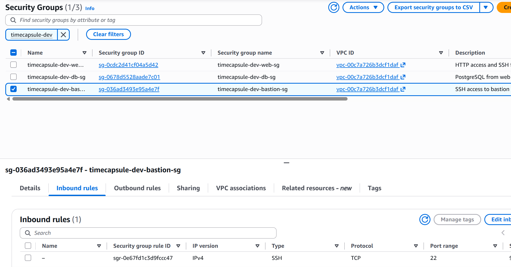

Скрин 1. Входящие правила timecapsule-dev-bastion-sg: SSH разрешён только с моего IP-адреса.

 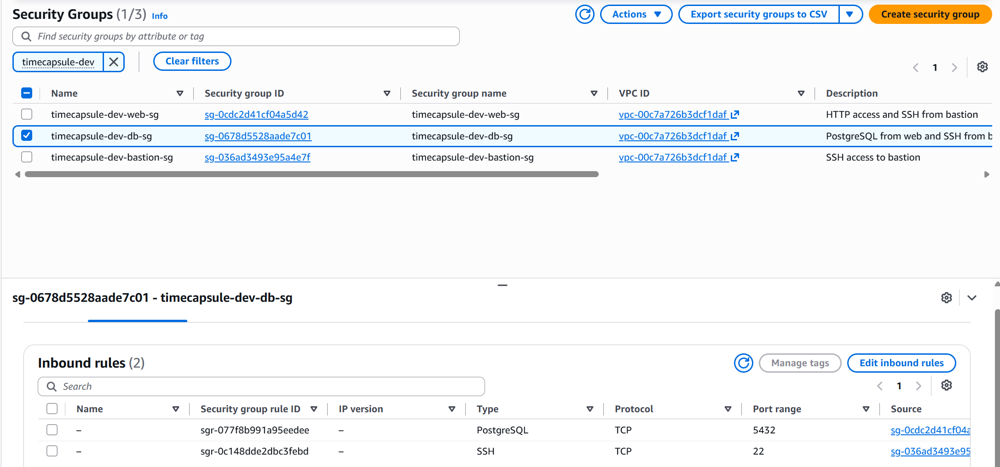

Скрин 2. Входящие правила timecapsule-dev-web-sg: HTTP доступен из интернета, SSH разрешён согласно настройкам лабораторной работы.

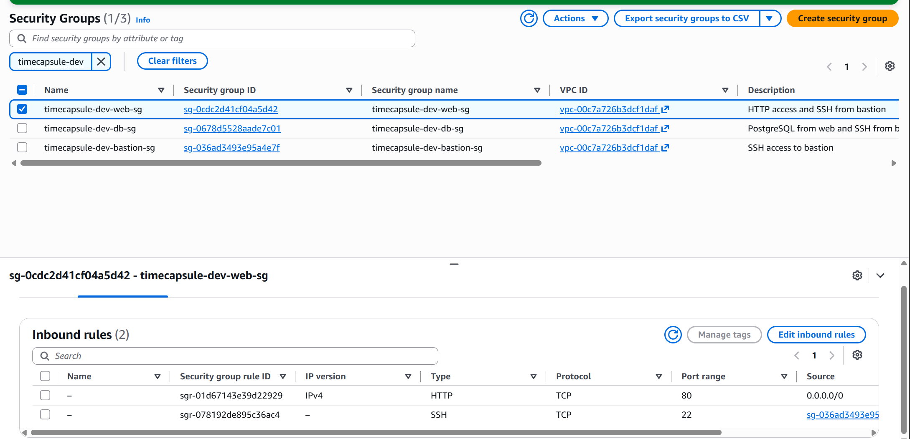

Скрин 3. Входящие правила timecapsule-dev-db-sg: доступ к PostgreSQL разрешён от web-сервера, а не напрямую из интернета.

Почему в db-sg источником указана группа web-sg, а не адрес веб-сервера или диапазон 10.0.0.0/16? Группа означает все серверы, которые в ней состоят, а не конкретные адреса. Если веб-сервер пересоздадут и адрес поменяется, правило все равно будет работать. Диапазон 10.0.0.0/16 открыл бы базу всем серверам сети, в том числе bastion, а адрес одного сервера придется править при каждой замене.

### Задание 5. Проверка публичного и приватного доступа
---
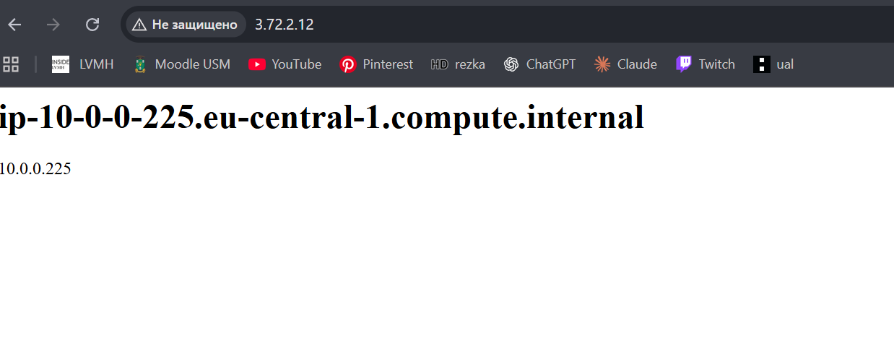

Скрин 1. Страница web-сервера открывается в браузере по его публичному IP-адресу.

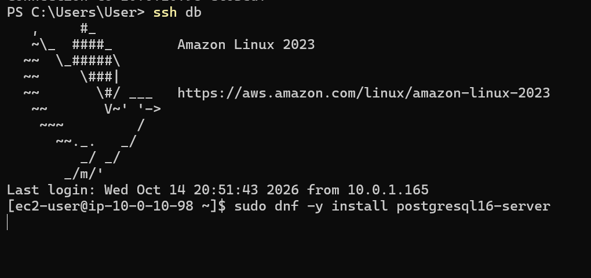

Скрин 2. Установка пакетов на db-сервер без NAT Gateway не завершается, поскольку у сервера нет выхода в интернет.

Почему db-server не может скачать пакеты, хотя web-server это делает? Что нужно добавить в сеть, чтобы это стало возможно, и при этом db-server остался недоступным из интернета? У db-server нет публичного адреса, а в таблице private-rt нет маршрута 0.0.0.0/0, поэтому исходящие пакеты некуда отправлять. Нужно добавить NAT Gateway в публичную подсеть и маршрут на него в private-rt. Из интернета сервер при этом по прежнему недоступен, потому что NAT пропускает только ответы на соединения, которые начал сам сервер.

### Задание 6. Временный NAT Gateway
---
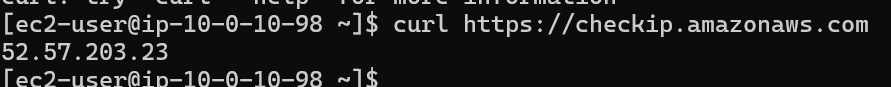
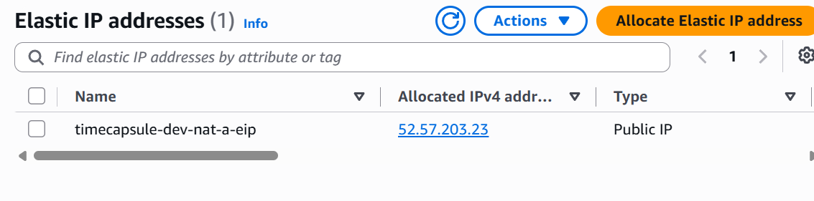

Скрин 1. Вывод curl https://checkip.amazonaws.com на db-сервер показывает внешний IP-адрес NAT Gateway. Elastic IP NAT Gateway, совпадает с адресом из вывода curl.

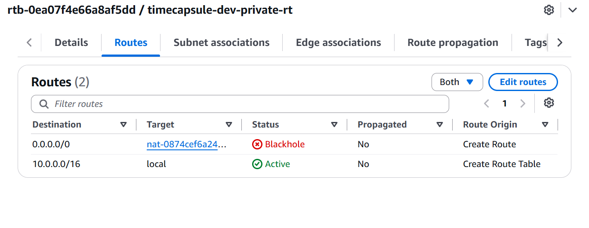

Скрин 2. После удаления NAT Gateway маршрут 0.0.0.0/0 в приватной таблице маршрутов находится в состоянии Blackhole.

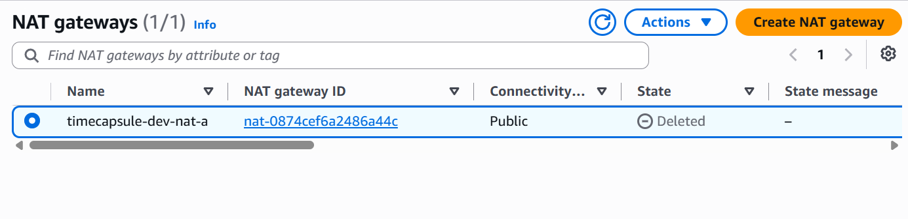

Скрин 3. NAT Gateway timecapsule-dev-nat-a находится в состоянии Deleted.

Какой адрес вернула первая команда? Сравните его с Elastic IP NAT Gateway. Почему это не адрес db-server? Команда вернула адрес, который совпадает с Elastic IP NAT Gateway. Это не адрес db-server, потому что NAT заменяет приватный адрес сервера своим публичным адресом, а у самого сервера публичного адреса нет.

Что делает каждый из трех механизмов ограничения доступа к базе? Что произойдет, если ошибиться только в одном? Отсутствие публичного адреса и маршрута в Internet Gateway не дает добраться до сервера из интернета. Security Group db-sg пропускает порт 5432 только от web-sg. Файл pg_hba.conf решает, какой пользователь, в какую базу и с каких адресов может войти. Если ошибиться в одном, остальные два все равно защищают базу.

Почему PostgreSQL продолжает работать после удаления NAT Gateway? Что придется сделать, когда понадобится установить обновления безопасности? NAT нужен только для выхода в интернет, а веб-сервер подключается к базе внутри VPC по локальному маршруту. Для обновлений безопасности придется снова создать временный NAT Gateway и маршрут, поставить обновления и удалить все обратно.

### Задание 7. Проверка подключения к базе данных и тегов
---
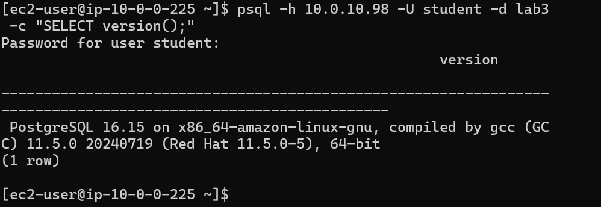

Скрин 1. С web-сервера выполнен запрос к PostgreSQL, получена информация о версии сервера базы данных.

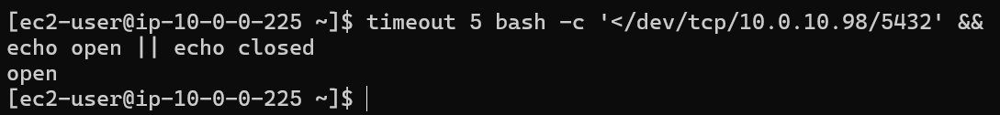

Скрин 2. Проверка порта 5432 с web-сервера подтверждает доступность PostgreSQL.

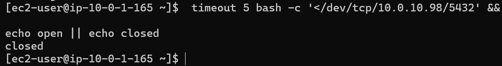

Скрин 3. Проверка порта 5432 с bastion показывает результат доступа к базе данных из bastion.

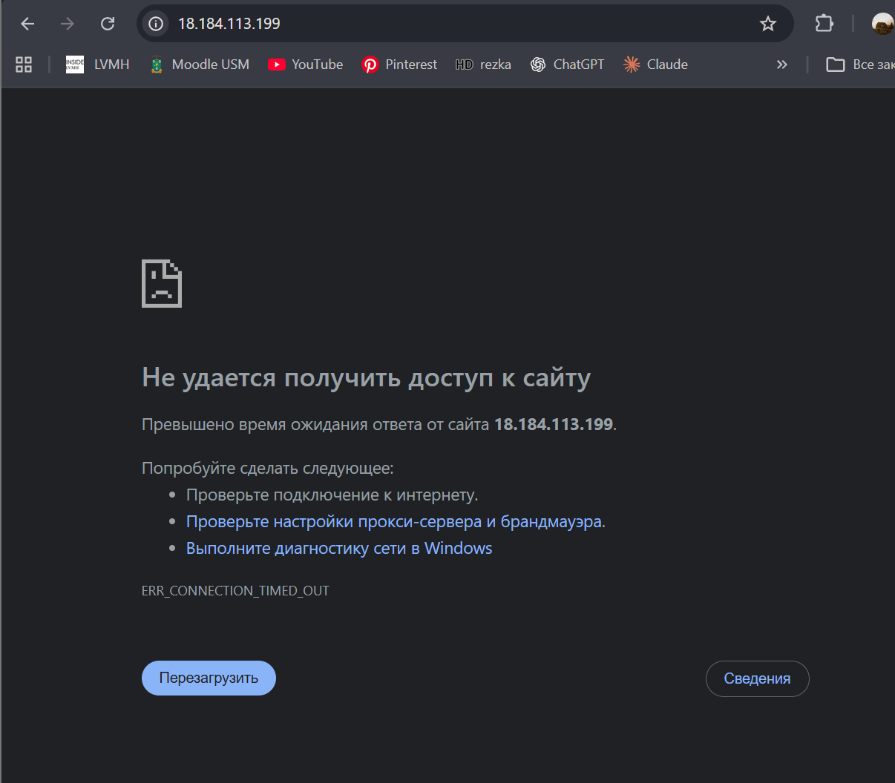

Скрин 4. Результат эксперимента с Network ACL показывает влияние правил сетевого доступа на соединение.

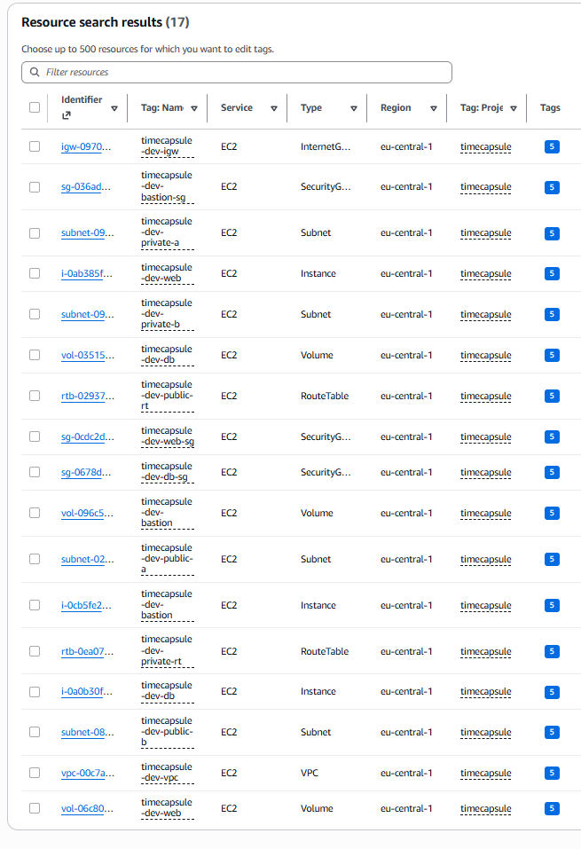

Скрин 5. В Tag Editor отображаются ресурсы проекта с тегом Project = timecapsule.

Почему с web-server порт открыт, а с bastion нет, хотя оба сервера в одной VPC и маршрут между ними есть? Правило в db-sg разрешает порт 5432 только источникам из группы web-sg. Bastion в этой группе не состоит, поэтому Security Group отбрасывает его пакеты, хотя маршрут есть.

Почему запрос с db-server на github.com не проходит? Можно ли из интернета подключиться к порту 5432 db-server? Запрос не проходит, потому что в private-rt нет маршрута в интернет и у сервера нет публичного адреса. Из интернета к порту 5432 подключиться нельзя. По цепочке из лекции, маршрута из Internet Gateway к подсети нет, у сервера нет публичного адреса, а фильтры Network ACL и Security Group пропускают порт только от web-sg.

Почему заблокировано и SSH, и сайт, хотя вы не меняли Security Group? Почему с телефона сайт открывается? Почему правило должно иметь номер меньше 100? Network ACL работает на границе подсети еще до Security Group, а запросы на SSH и на сайт приходят с моего адреса, поэтому блокируются оба. С телефона по мобильному интернету у меня другой внешний адрес, поэтому сайт открывается. Network ACL проверяет правила по возрастанию номеров и применяет первое подходящее, а правило 100 разрешает весь трафик, поэтому запрет должен идти раньше.

Как по тегам найти все ресурсы, которые нужно удалить после окончания проекта? Зачем нужен тег Owner, если аккаунт личный? В Tag Editor нужно выбрать регион, все типы ресурсов и тег Project равный timecapsule, тогда покажутся все ресурсы проекта. Тег Owner показывает, кто отвечает за ресурс. В личном аккаунте он не обязателен, но если аккаунт станет общим, он поможет не удалить чужое и найти ответственного.

## 3. Задания продвинутого уровня
---

Что содержит образ? Какие данные из ЛР2 оказались на app-server без установки? Где сейчас хранится база данных приложения? Образ это снимок дисков сервера вместе с описанием. В нем операционная система, nginx, PHP, код приложения, загруженные файлы и данные локальной базы. Поэтому на app-server сразу оказались приложение, пользователи и капсулы из ЛР2. Сейчас база хранится на db-server в приватной подсети.

### Задание 9. Elastic IP
---
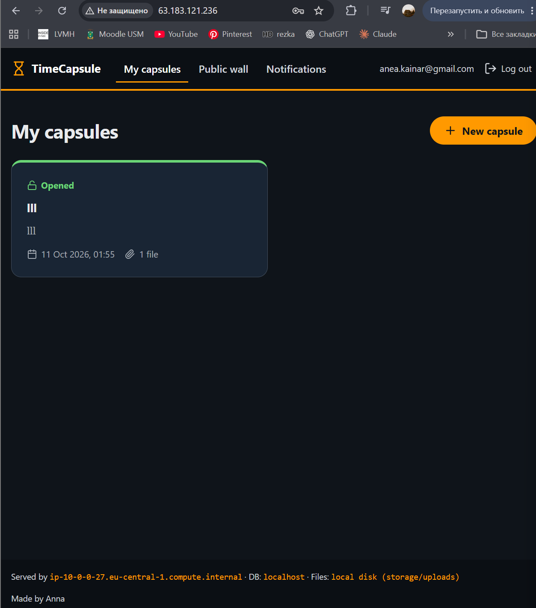

Скрин 1. Показывает работающую страницу приложения TimeCapsule, открытую по Elastic IP сервера timecapsule-dev-app.

Почему Elastic IP нужен app-server, но не нужен bastion? Пользователи заходят на app-server по одному адресу, поэтому адрес не должен меняться после остановки и запуска сервера. Bastion нужен только мне для SSH, и я просто обновляю его адрес в файле config.

Сколько стоит Elastic IP, пока сервер остановлен, и почему? Около 0,005 доллара в час, это примерно 3,6 доллара в месяц. AWS берет плату за выделенный публичный адрес, пока он существует, даже если сервер остановлен.

Понадобится ли Elastic IP, когда перед сервером появится балансировщик нагрузки? Нет, не понадобится. Пользователи будут заходить на DNS-имя балансировщика, и Elastic IP на app-server можно освободить.

Зачем для базы в отдельной сети нужен новый сильный пароль, если порт 5432 и так закрыт Security Group? Security Group это только один слой защиты. Если ее настроят неправильно или взломают веб-сервер, пароль остается последним барьером. Старый пароль из ЛР2 к тому же уже мог где то светиться.

### Задание 11. Приватная зона Route 53
---
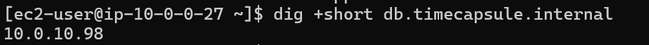

Скрин 1. Показывает результат команды dig +short db.timecapsule.internal, выполненной на app-server.

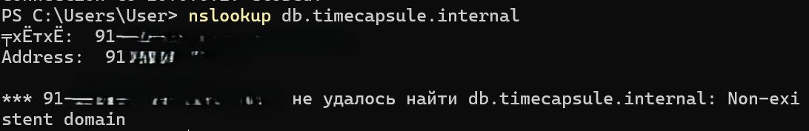

Скрин 2. Показывает результат nslookup db.timecapsule.internal на локальном компьютере.

Почему с app-server имя находится, а с вашего компьютера нет? Приватная зона видна только ресурсам той VPC, с которой она связана. Мой компьютер использует обычный публичный DNS, в котором такого имени нет.

Что придется изменить, если db-server пересоздадут с другим адресом? Нужно поменять только значение записи db в зоне timecapsule.internal. Настройки приложения менять не нужно, потому что оно подключается по имени.

### Задание 12. Перенос данных и переключение приложения
---
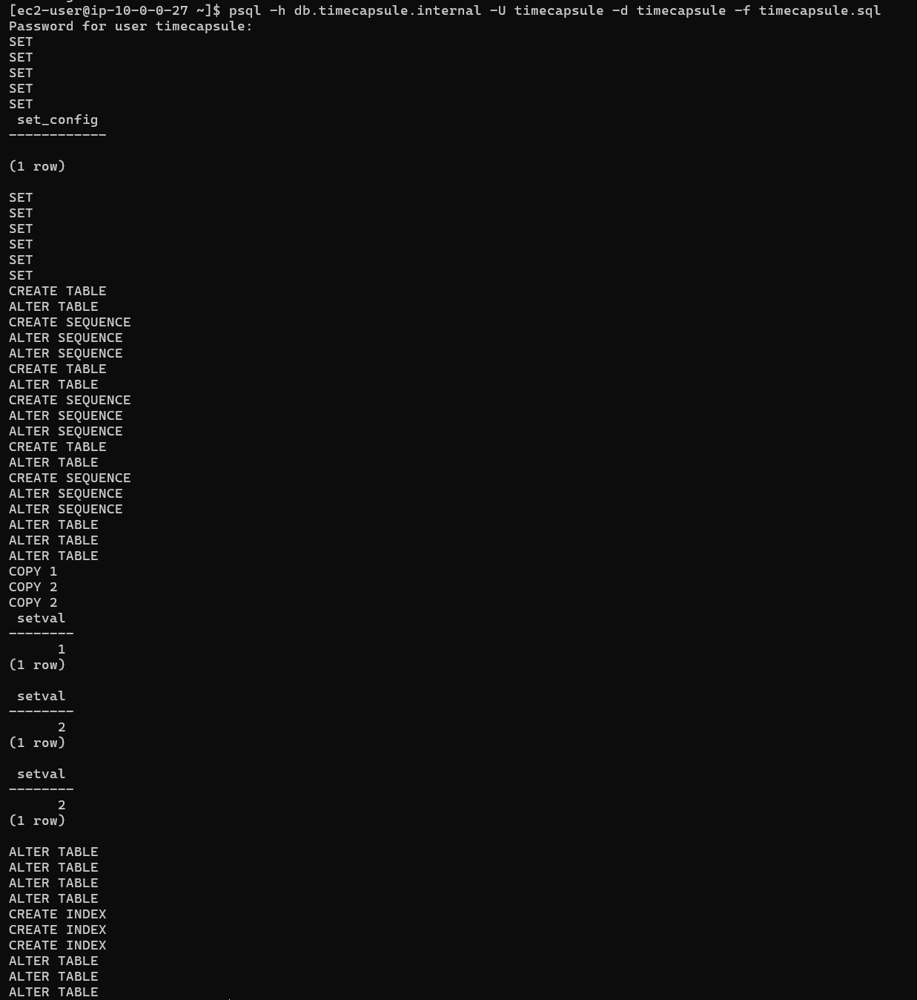

Скрин 1. Показывает успешный импорт данных из файла timecapsule.sql в удалённую базу данных командой psql -f.

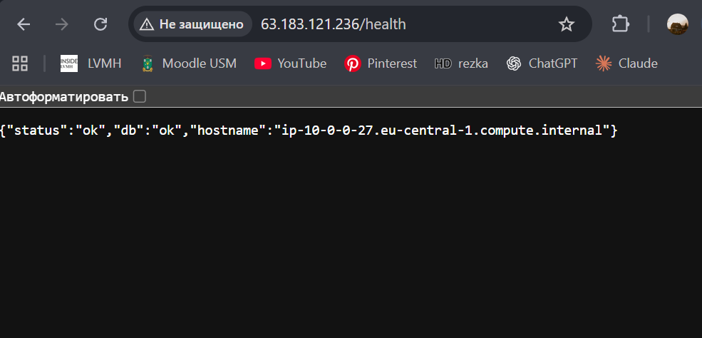

Скрин 2. Показывает ответ /health со статусом "db":"ok" после переключения приложения на удалённую базу.

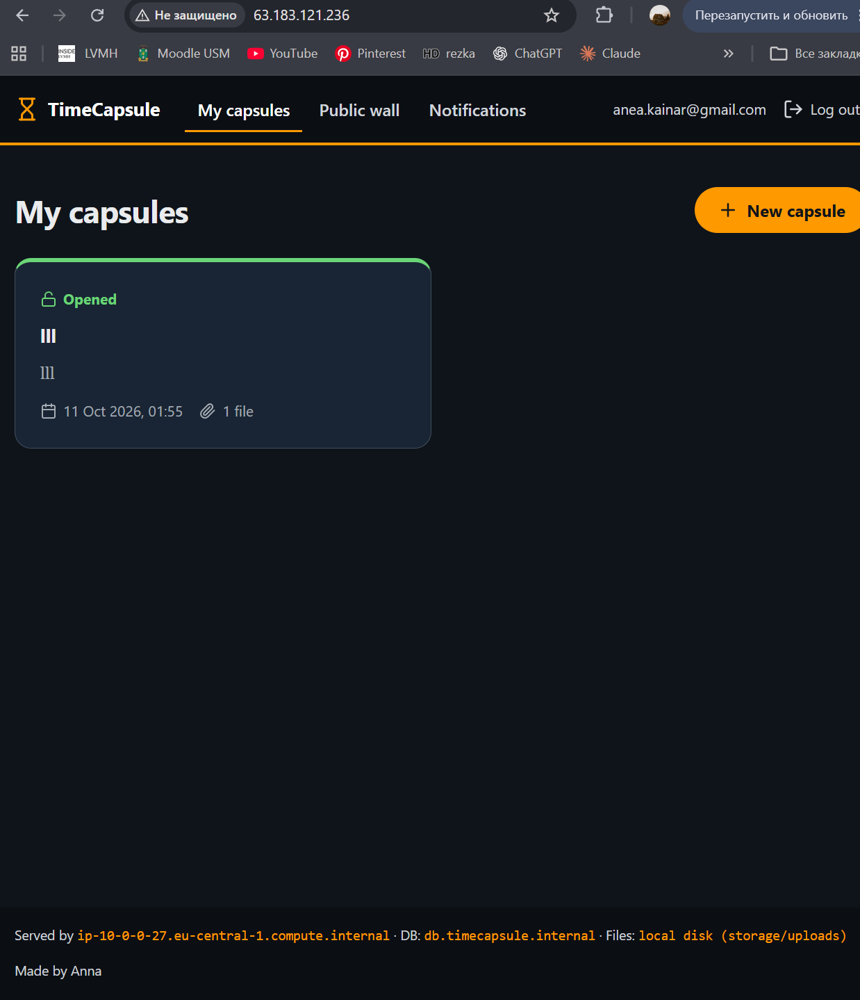

Скрин 3. Показывает главную страницу приложения с сохранёнными капсулами, созданными в ЛР2.

Где лежат файлы, которые пользователи прикрепили к капсулам? Что с ними будет, если app-server удалить? Они лежат на локальном диске app-server и переехали вместе с образом, а не вместе с базой. Если app-server удалить, диск удалится вместе с ним и файлы пропадут.

### Задание 13. Деплой и обслуживание
---
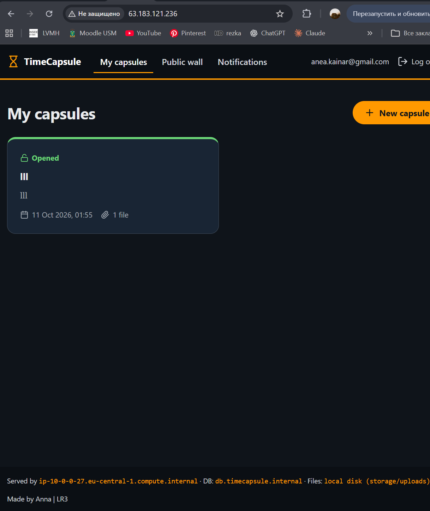

Скрин 1. Показывает приложение с добавленной строкой LR3, подтверждающей успешный деплой новой версии.

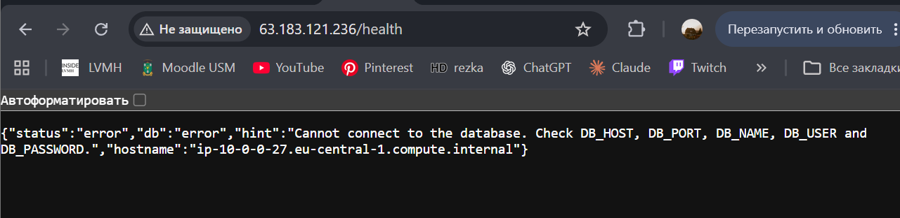

Скрин 2. Показывает результат /health при остановленном db-server. Приложение не может подключиться к базе данных.

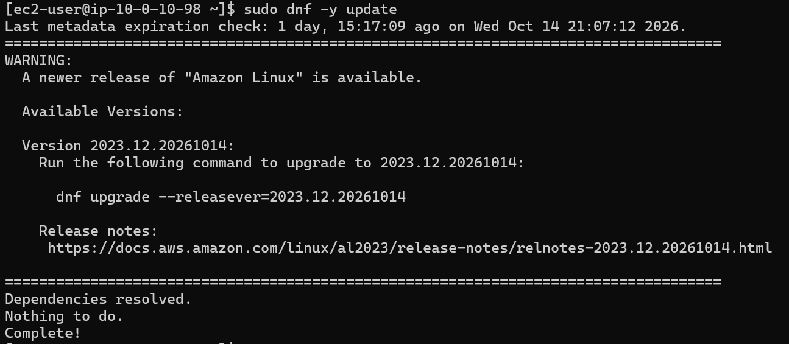

Скрин 3. Показывает выполнение команды sudo dnf -y update на db-server после временного восстановления доступа в интернет через NAT Gateway.

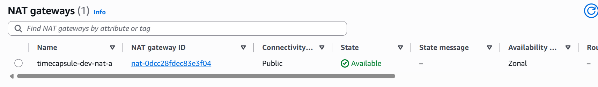

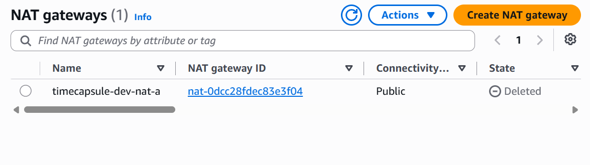

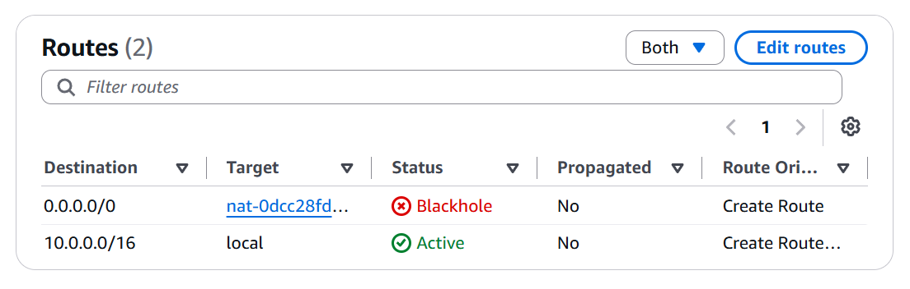

Скрин 4. Проверка состояния NAT Gateway: Available, Deleted и маршрута в состоянии Blackhole после удаления шлюза.

Новую версию я выложила способом A из ЛР2. Я зашла на app-server через bastion командой ssh app и выполнила git pull в папке приложения, потом перезагрузила php-fpm. Команды composer install и init-db.php не понадобились, потому что поменялся только шаблон страницы.

Почему в командах варианта A ничего менять не пришлось? Команды выполняются на самом сервере и не зависят от устройства сети. Изменился только путь подключения, а он записан в файле config с помощью ProxyJump через bastion.

Что показал health и почему? Изменился ли приватный адрес db-server после остановки и запуска? Когда db-server был остановлен, health показал статус error и подсказку, что не удается подключиться к базе. Приложение работало, но не могло открыть соединение с базой. Приватный адрес db-server не изменился и остался 10.0.10.98, поэтому после запуска сервера приложение заработало само, без изменений на app-server.

### Задание 14. Архитектура и решение
---
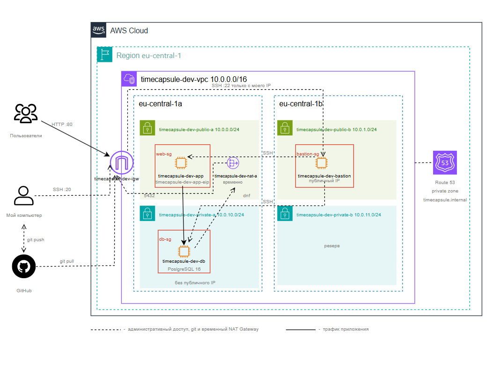
Скрин. 1. Архитектура проекта, VPC с двумя зонами, четырьмя подсетями, bastion, app-server, db-server, приватной зоной Route 53 и временным NAT Gateway.

Решение о размещении базы данных записано в файле docs/adr/0002-database-placement.md, ссылка: https://github.com/kkkiar-cloud/timecapsule/blob/main/docs/adr/0002-database-placement.md

### Вопросы для устной защиты
---

- Как проходит запрос пользователя от браузера до базы данных? Какие маршруты и правила фильтрации он проходит? Браузер идет на Elastic IP сервера app-server. Пакет попадает в Internet Gateway, по таблице public-rt уходит в подсеть public-a, проходит Network ACL и Security Group web-sg, которая разрешает порт 80. Приложение берет адрес базы по имени db.timecapsule.internal и идет на db-server по локальному маршруту. Там пакет проходит Network ACL и db-sg, которая разрешает порт 5432 только от web-sg, а потом pg_hba.conf и проверку пароля.

- Злоумышленник знает приватный IP db-server. Что ему нужно, чтобы подключиться к базе? Из интернета маршрута к db-server нет, поэтому ему сначала нужно попасть внутрь VPC на сервер из группы web-sg. Потом ему нужны правильные имя пользователя, имя базы и пароль, а подключение должно идти с адреса подсети public-a, иначе pg_hba.conf его отклонит.

- Чем временный NAT Gateway лучше постоянного и какие неудобства он создает? Он оплачивается только за часы работы, а постоянный стоил бы около 1,25 доллара в сутки. Неудобство в том, что его каждый раз нужно создавать и удалять руками, ждать несколько минут, добавлять и убирать маршрут, подписывать Elastic IP и не забыть все удалить.

- Как изменится схема, если приложение должно пережить отказ зоны eu-central-1a? Сейчас и app-server, и db-server стоят в зоне 1a. Не хватает второго сервера приложения в зоне 1b, реплики базы в подсети private-b, балансировщика нагрузки между двумя зонами и автоматического переключения на реплику.

### Итог
---
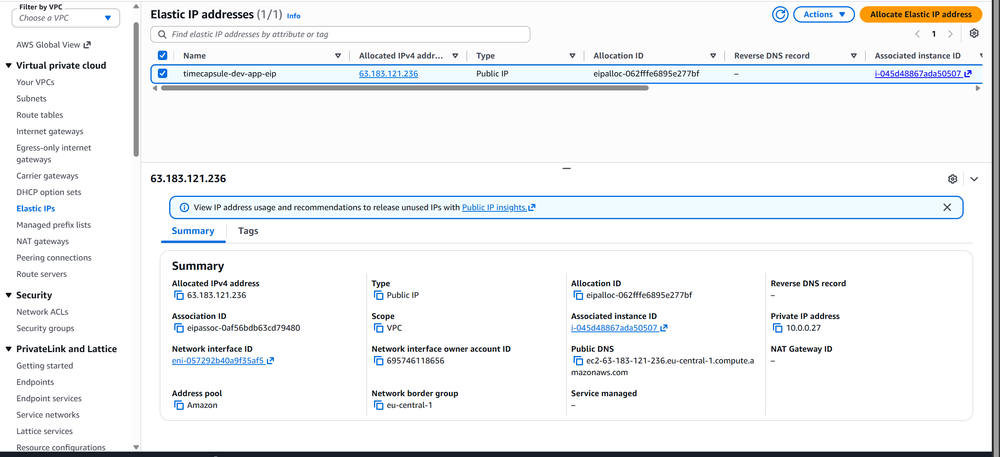
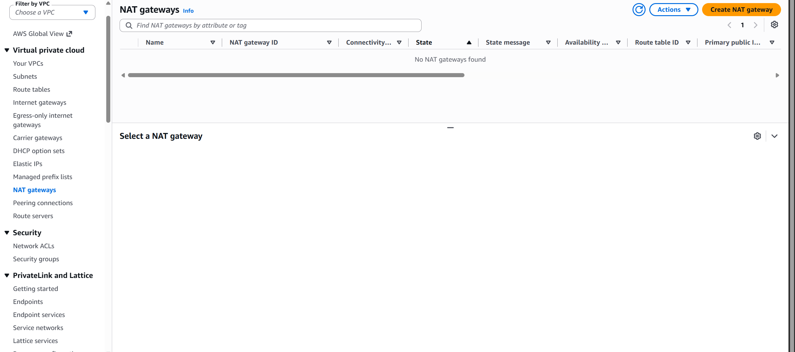
Скриншоты Elastic IPs и NAT gateways после завершения работы.
