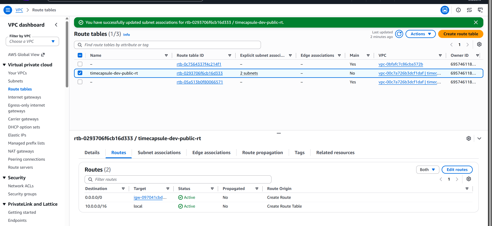
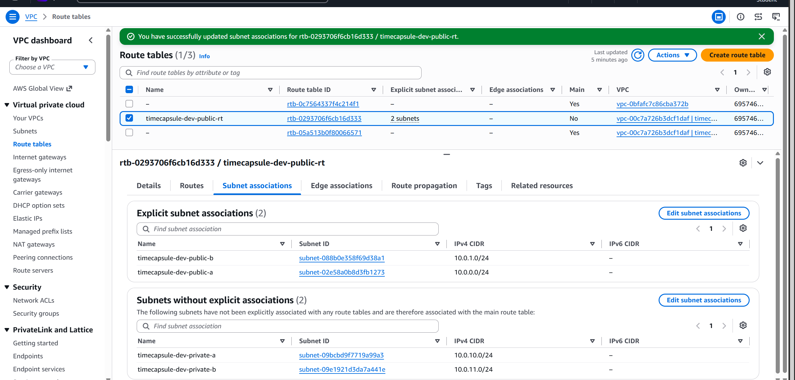
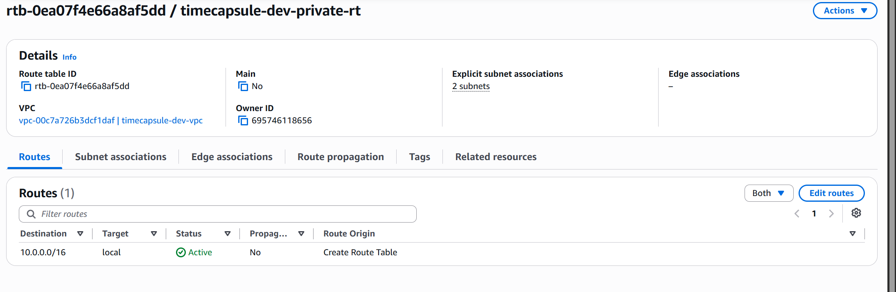
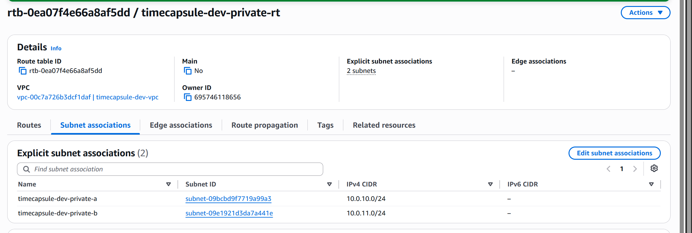

# Отчёт по 3 лабораторной работе AWS

## 1. 
- ФИО: Кайнар Анна
- Группа: IA2403
- Выбранный уровень: Продвинутый
- k = 30
- Репозиторий: https://github.com/kkkiar-cloud/timecapsule
---

## 2. Задания базового уровня

### Задание 1. План адресов

| Подсеть | Зона доступности | Диапазон | Первый и последний доступный адрес | Количество адресов |
|---|---|---|---|---:|
| public-a | eu-central-1a | 10.0.0.0/24 | 10.0.0.4 – 10.0.0.254 | 251 |
| public-b | eu-central-1b | 10.0.1.0/24 | 10.0.1.4 – 10.0.1.254 | 251 |
| private-a | eu-central-1a | 10.0.10.0/24 | 10.0.10.4 – 10.0.10.254 | 251 |
| private-b | eu-central-1b | 10.0.11.0/24 | 10.0.11.4 – 10.0.11.254 | 251 |

### Задание 3. Маршруты public-rt и private-rt и их связи с подсетями

Скрин 1./Скрин 2. Показывает выбранную public-rt, её маршруты (включая 0.0.0.0/0 через Internet Gateway) и связии с публичными подсетями timecapsule-dev-public-a и timecapsule-dev-public-b

Скрин 3./Скрин 4. Показывает вкладку Routes для private-rt, где виден только локальный маршрут (10.0.0.0/16) и связи с приватными подсетями timecapsule-dev-private-a и timecapsule-dev-private-b.

### Задание 4. Security Groups

Скрин 5. Входящие правила `timecapsule-dev-bastion-sg`: SSH разрешён только с моего IP-адреса.

 

Скрин 6. Входящие правила `timecapsule-dev-web-sg`: HTTP доступен из интернета, SSH разрешён согласно настройкам лабораторной работы.

Скрин 7. Входящие правила `timecapsule-dev-db-sg`: доступ к PostgreSQL разрешён от web-сервера, а не напрямую из интернета.

### Задание 5. Проверка публичного и приватного доступа

Скрин 8. Страница web-сервера открывается в браузере по его публичному IP-адресу.

Скрин 9. Установка пакетов на db-сервер без NAT Gateway не завершается, поскольку у сервера нет выхода в интернет.

### Задание 6. Временный NAT Gateway

Скрин 10. Вывод `curl https://checkip.amazonaws.com` на db-сервер показывает внешний IP-адрес NAT Gateway.

Скрин 11. После удаления NAT Gateway маршрут `0.0.0.0/0` в приватной таблице маршрутов находится в состоянии `Blackhole`.

Скрин 12. NAT Gateway `timecapsule-dev-nat-a` находится в состоянии `Deleted`.

### Задание 7. Проверка подключения к базе данных и тегов

Скрин 13. С web-сервера выполнен запрос к PostgreSQL, получена информация о версии сервера базы данных.

Скрин 14. Проверка порта `5432` с web-сервера подтверждает доступность PostgreSQL.

Скрин 15. Проверка порта `5432` с bastion показывает результат доступа к базе данных из bastion.

Скрин 16. Результат эксперимента с Network ACL показывает влияние правил сетевого доступа на соединение.

**Скрин 17.** В Tag Editor отображаются ресурсы проекта с тегом `Project = timecapsule`.
