# Отчет по лабораторной работе 4. Облачные хранилища. Amazon S3

* ФИО: Кайнар Анна
* Группа: IA2403
* Специальность: Informatică aplicată
* Выбранный уровень: продвинутый
* Репозиторий: https://github.com/kkkiar-cloud/timecapsule

Все команды я выполняла в Git Bash через AWS CLI на своем компьютере, потому что AWS CloudShell пока не работает, но скоро заработает. Бакет называется timecapsule-dev-uploads-kkkiar, регион eu-central-1.

---
# 1. Базовый уровень

## Задание 1. Бакет и объекты в консоли

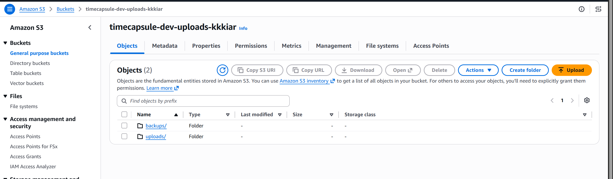

*Скрин. 1. Бакет timecapsule-dev-uploads-kkkiar с папками uploads и backups.*

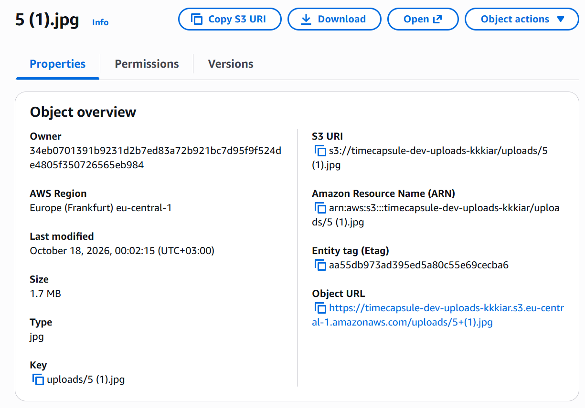

*Скрин. 2. Свойства картинки в бакете: ключ, Type, ETag и Object URL.*

**Какой ключ у картинки?**
Ключ картинки это uploads/5 (1).jpg. Ключ в S3 это полный путь к объекту вместе с префиксом папки.

**Почему Object URL не открывается, хотя я владелец бакета?**
Бакет закрыт настройкой Block all public access, а ссылка Object URL открывается без подписи, то есть как анонимный запрос. Анонимному запросу S3 отвечает AccessDenied. Владелец получает доступ только тогда, когда запрос подписан его ключами.

**Что на самом деле создала кнопка Create folder?**
Она создала пустой объект нулевого размера, ключ которого заканчивается на слеш, например uploads/. Настоящих папок в S3 нет, есть только ключи с общим префиксом, а консоль Скринует их как папки.
 
## Задание 2. Объекты из командной строки

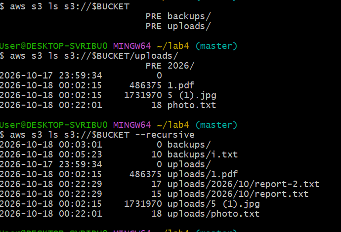

*Скрин. 3. Содержимое бакета тремя способами: верхний уровень, папка uploads и рекурсивный список.*

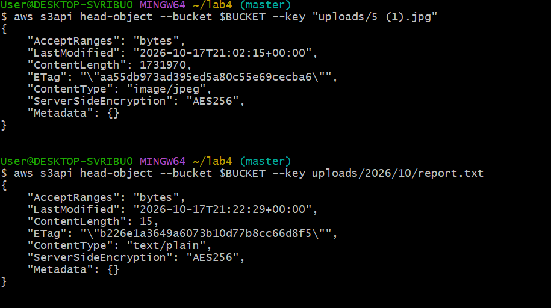

*Скрин. 4. Метаданные картинки и report.txt без скачивания: тип содержимого, размер, ETag и шифрование.*

**Почему первая команда ls показывает PRE uploads/ и PRE backups/, а третья показывает полные ключи?**
Без ключа recursive ls показывает только один уровень и группирует объекты по префиксу до слеша, а группы помечает словом PRE. С ключом recursive команда обходит все уровни и печатает каждый объект с его полным ключом.

**Какой Content-Type получил report.txt, хотя я его не указывала?**
Он получил text/plain. Команда aws s3 cp определила тип сама по расширению txt и записала его при загрузке. Картинка так же получила image/jpeg.

## Задание 3. Политика бакета: только HTTPS

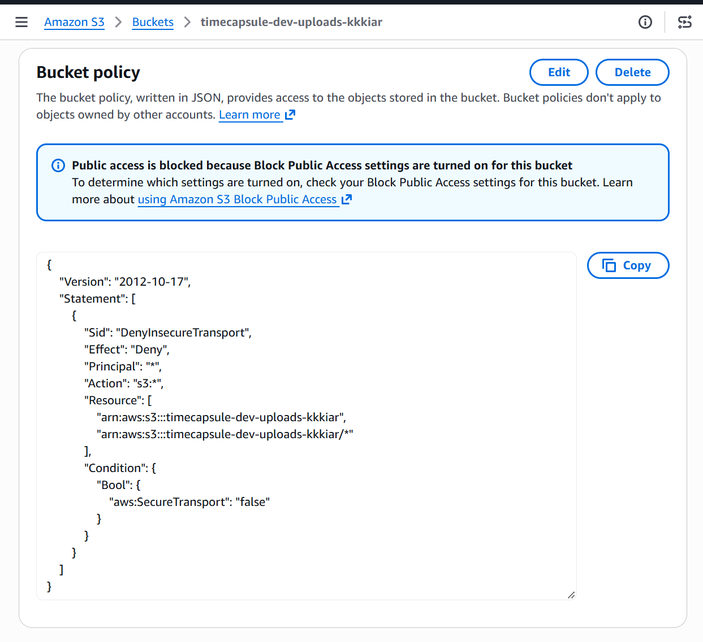

*Скрин. 5. Политика бакета, запрещающая запросы без HTTPS.*

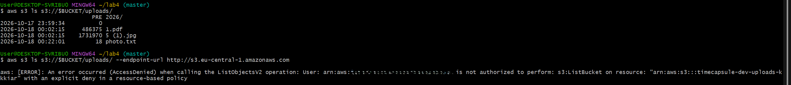

*Скрин. 6. Проверка политики: запрос по HTTPS проходит, запрос по HTTP получает AccessDenied.*

**Почему вторая команда получает AccessDenied, хотя у меня права администратора?**
В политике бакета стоит явный запрет Deny для запросов, у которых aws:SecureTransport равно false. Явный запрет в AWS сильнее любого разрешения, поэтому права администратора не помогают. В тексте ошибки так и написано, что причина в явном запрете в политике ресурса.

**Почему Block Public Access не помешал сохранить политику с Principal равным звездочке?**
Block Public Access блокирует политики, которые открывают доступ всем, то есть разрешения Allow для всех. Моя политика наоборот запрещает доступ, поэтому она ничего не открывает и проверку проходит.

## Задание 4. Версионирование и защита от удаления

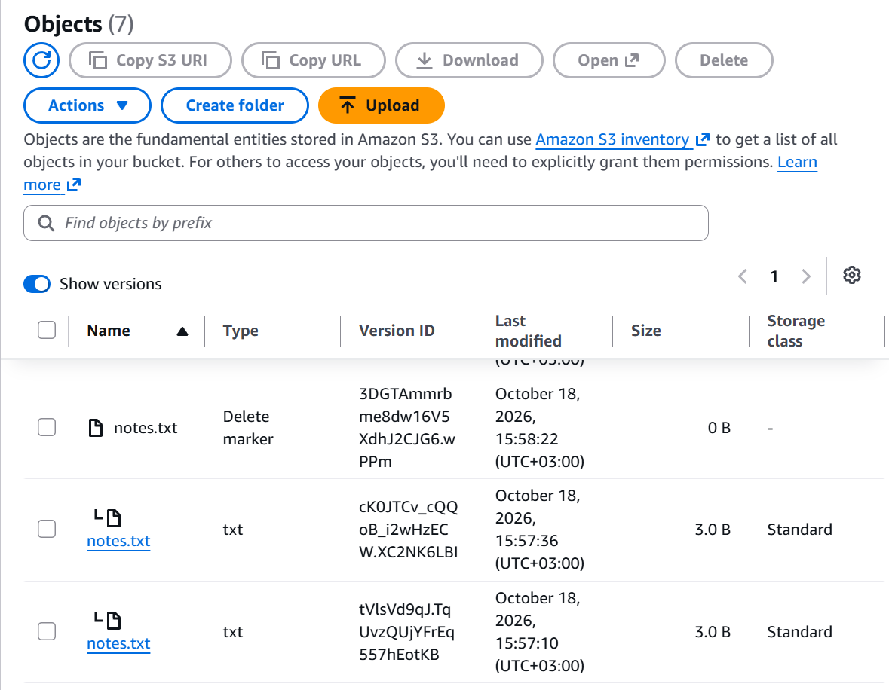

*Скрин. 7. Версии notes.txt после обычного удаления: появился маркер удаления, обе версии на месте.*

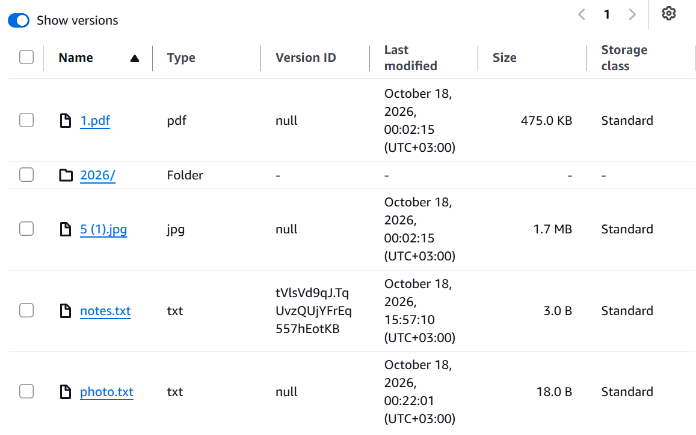
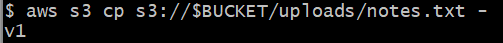

*Скрин. 8. Версии notes.txt после отката: удалена версия v2, текущей стала v1.*

**Чем удаление в шаге 3 отличается от удаления в шаге 5?**
В шаге 3 Show versions был выключен, и я удалила объект обычным способом. S3 при этом ничего не стер, а поставил поверх маркер удаления, и обе версии остались. В шаге 5 я удалила конкретную версию по ее идентификатору, и эта версия исчезла насовсем.

**Какое из них можно отменить?**
Отменить можно удаление с маркером: достаточно удалить сам маркер, и файл возвращается. Удаление конкретной версии отменить нельзя.

**Какой из двух способов защищает от случайного удаления, а какой нужно запрещать приложению?**
От случайного удаления защищает обычное удаление с маркером, потому что данные остаются. Удаление конкретной версии необратимо, поэтому его нужно запрещать приложению.

## Задание 5. Правило жизненного цикла

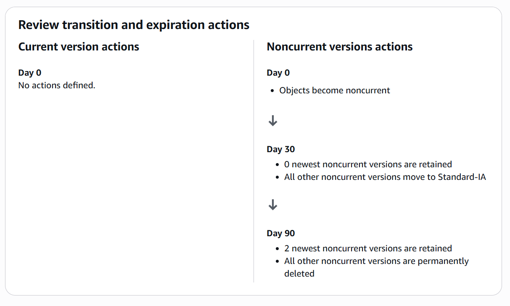

*Скрин. 9. Схема правила: неактуальные версии в Standard-IA через 30 дней и удаление через 90 дней, две новые версии сохраняются.*

**Как поведет себя правило для файла, который перезаписывали 10 раз за неделю? Какие версии и когда окажутся в Standard-IA, какие будут удалены?**
У такого файла будет одна текущая версия и девять неактуальных. Срок считается с момента, когда версия стала неактуальной. Примерно через 30 дней неактуальные версии должны перейти в Standard-IA, а через 90 дней все неактуальные версии удаляются, кроме двух самых новых. Значит, останется текущая версия и две самые новые неактуальные, а остальные семь исчезнут.

**Почему наши маленькие тестовые файлы в Standard-IA не попадут?**
S3 по умолчанию не переносит в Standard-IA объекты меньше 128 килобайт, а наши файлы весят несколько байт.

**Что такое незавершенная загрузка частями и почему за нее приходится платить?**
Большие файлы загружаются кусками. Если загрузку начали и не завершили, уже загруженные части остаются в бакете. В списке объектов их не видно, но место они занимают и оплачиваются, поэтому правило удаляет их через 7 дней.

## Задание 6. Подписанные URL

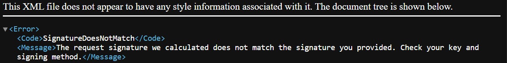

*Скрин. 10. Ответ S3 на ссылку с измененным ключом: SignatureDoesNotMatch.*

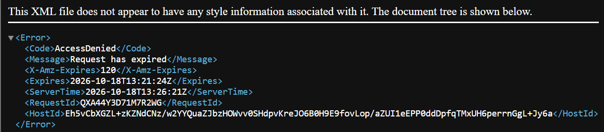

*Скрин. 11. Ответ S3 на ссылку после окончания срока: Request has expired.*

**Какие ошибки вернул S3 в шагах 3 и 4?**
Для ссылки с измененным ключом пришла ошибка SignatureDoesNotMatch. Для просроченной ссылки пришла ошибка AccessDenied с сообщением Request has expired.

**Почему нельзя получить другой файл, просто поменяв ключ в ссылке?**
Подпись считается от всех параметров запроса, в том числе от ключа объекта. Если поменять ключ, подпись перестает совпадать, и S3 отклоняет запрос.

**Обращалась ли команда aws s3 presign к S3, когда создавала ссылку?**
Нет. Ссылка вычисляется на моем компьютере по моим ключам, без запроса к S3. S3 проверяет подпись и срок только тогда, когда кто-то открывает ссылку.

---

# 2. Продвинутый уровень

## Задания 7 и 8. Политика приложения и проверка прав

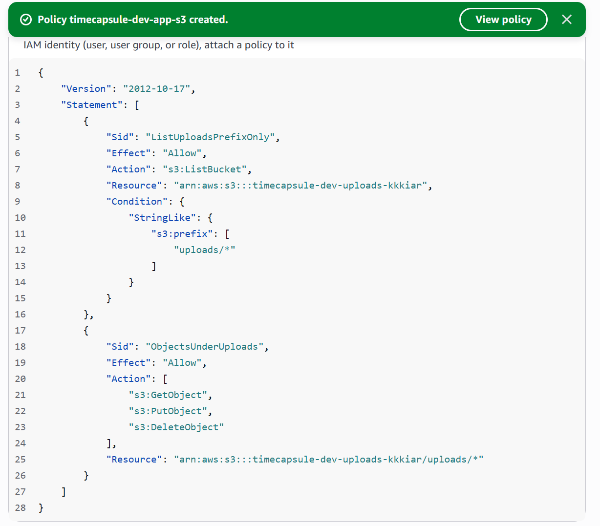

*Скрин. 12. Политика timecapsule-dev-app-s3: список только под uploads и чтение, запись и удаление объектов под uploads.*

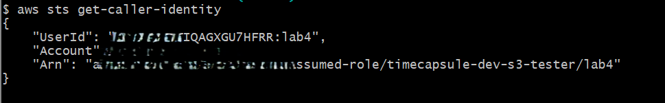

*Скрин. 13. Вызов get-caller-identity после assume-role: сессия роли timecapsule-dev-s3-tester.*

Таблица проверки прав. Колонку Ожидаю я заполнила до запуска команд, колонку Получил по результатам выполнения.

| № | Команда | Ожидаю | Получил | Какое правило сработало |
|---|---|---|---|---|
| 1 | aws s3 cp test.txt в uploads | Разрешено | Разрешено, файл загружен | Разрешение в политике приложения |
| 2 | aws s3 ls для uploads | Разрешено | Разрешено, показан список | Разрешение в политике приложения |
| 3 | aws s3 ls для корня бакета | AccessDenied | AccessDenied на ListBucket | Неявный запрет |
| 4 | aws s3 cp photo.txt на экран | Разрешено | Разрешено, выведен текст photo placeholder | Разрешение в политике приложения |
| 5 | aws s3 ls для backups | AccessDenied | AccessDenied на ListBucket | Неявный запрет |
| 6 | aws s3 cp test.txt в backups | AccessDenied | AccessDenied на PutObject | Неявный запрет |
| 7 | aws s3api list-object-versions | AccessDenied | AccessDenied на ListBucketVersions | Неявный запрет |
| 8 | aws s3api delete-object с идентификатором версии | AccessDenied | AccessDenied | Неявный запрет |
| 9 | aws s3 rm для uploads/test.txt | Разрешено | Разрешено, объект удален | Разрешение в политике приложения |
| 10 | aws s3 ls для uploads по адресу http | AccessDenied | AccessDenied, в ошибке явный запрет в политике ресурса | Явный запрет в политике бакета |

В строках 3, 5, 6 и 7 AWS пишет, что ни одна политика не разрешает это действие - это и есть неявный запрет.

**Почему ListBucket относится к ресурсу бакет, а GetObject к ресурсу объект? Что произойдет, если перепутать ARN в этих двух правилах?**
Список объектов это действие над самим бакетом, а чтение файла это действие над отдельным объектом. Поэтому для ListBucket указывается ARN бакета, а для GetObject ARN объектов, который заканчивается на uploads и звездочку. Если перепутать ARN, право не совпадет с ресурсом, и AWS ответит AccessDenied, хотя в политике оно как будто есть.

**Чем политика доверия роли отличается от политики прав?**
Политика доверия говорит, кто может взять роль на себя. Политика прав говорит, что роль может делать, когда ее взяли. У тестовой роли доверие выдано моему аккаунту, а права дает политика timecapsule-dev-app-s3.

**Что на самом деле произошло с test.txt после команды 9 и можно ли его восстановить?**
Так как включено версионирование, команда не стерла файл, а поставила маркер удаления. Версия файла осталась в бакете. Восстановить можно, если удалить маркер в консоли под своим пользователем.

**Сможет ли злоумышленник, получивший учетные данные приложения, уничтожить файлы пользователей без возможности восстановления? А если бы в политике было s3 со звездочкой?**
Не сможет. У приложения нет прав ListBucketVersions и DeleteObjectVersion, поэтому оно не видит старые версии и не может удалить их окончательно. Максимум оно поставит маркер удаления, который можно снять. Если бы в политике было s3 со звездочкой, он смог бы удалять версии насовсем и очистить всю историю.

## Задание 9. Роль сервера

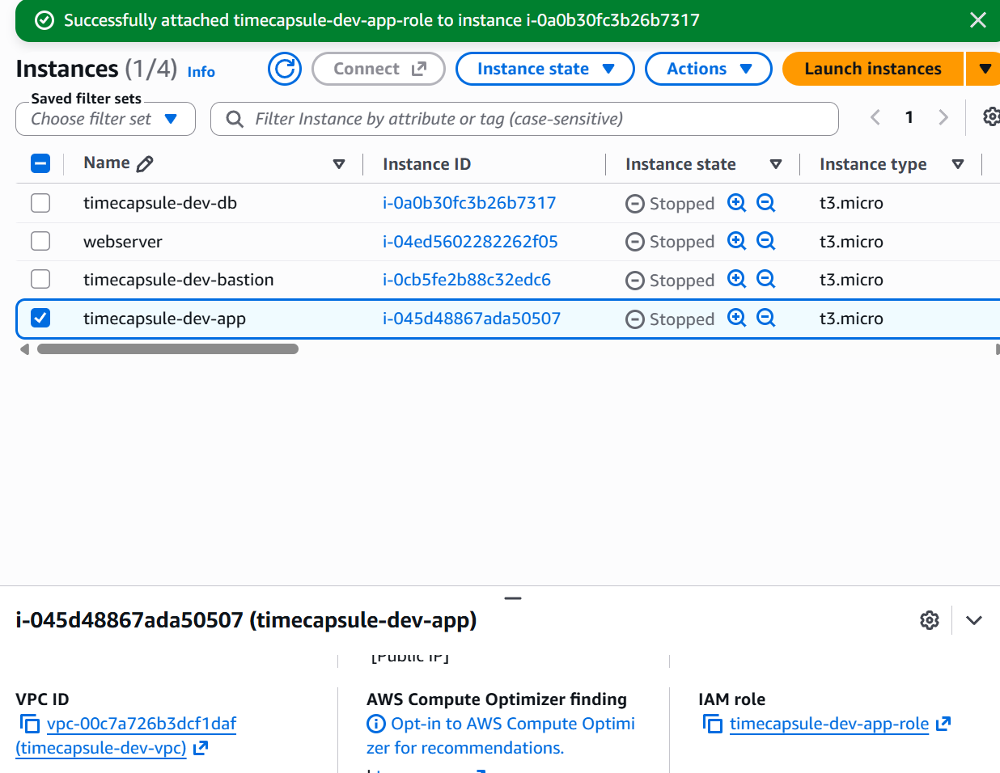
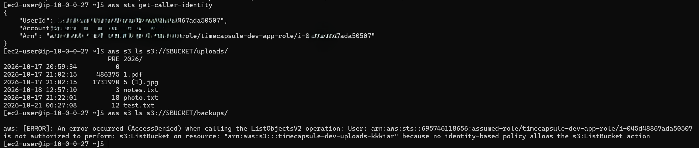

*Скрин. 14. Права app-server: сессия роли timecapsule-dev-app-role, список uploads разрешен, список backups запрещен.*

**Где AWS CLI на сервере взял учетные данные, если я не выполняла aws configure и не вызывала assume-role?**
Роль привязана к серверу, и EC2 выдает ее временные ключи через сервис метаданных на самом сервере. CLI и SDK сами находят эти ключи и обновляют их.

**Чем политика доверия этой роли отличается от тестовой?**
У тестовой роли доверие выдано моему аккаунту, то есть пользователь может ее взять. У роли сервера доверие выдано сервису EC2, поэтому ее может получить только сам сервер.

**Почему такие учетные данные безопаснее ключа доступа в файле env?**
Временные ключи роли сами истекают и обновляются, и их нет ни в файлах, ни в репозитории, поэтому нечего украсть или случайно опубликовать. Ключ доступа в файле env живет, пока его не удалят, и при утечке им можно пользоваться бесконечно.

## Задание 10. Перенос существующих файлов

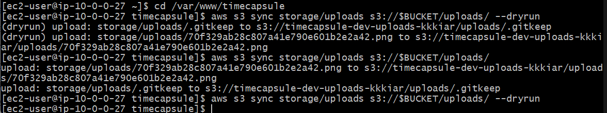

*Скрин. 15. Перенос файлов в бакет: aws s3 sync и повторная проверка с dryrun.*

**Хватило ли для aws s3 sync прав политики приложения? Какие из разрешенных действий использовала команда?**
Прав хватило. Команда использовала ListBucket, чтобы сравнить содержимое бакета под uploads, и PutObject, чтобы копировать недостающие файлы.

## Задание 11. Модуль хранения на S3

Модуль хранения src/storage.php переписан на работу с S3. Функции storage_save, storage_delete и storage_stream остались с прежними именами, поэтому остальной код приложения не менялся. Сохранение идет через putObject с правильным типом содержимого, удаление через deleteObject, а скачивание через перенаправление на подписанный URL сроком 5 минут. В подвале страницы теперь написано имя бакета. Ключей доступа в коде и в env нет.

Изменения в репозитории:

* Коммит Migrate file storage to Amazon S3: https://github.com/kkkiar-cloud/timecapsule/commit/330d078a52d3fa10c5f5e6658c453fb9648b8a15
* Следующий коммит с SDK, настройками и подвалом: https://github.com/kkkiar-cloud/timecapsule/commit/94a020f3a33857a9f00a278597fe0699dad59845

## Задание 12. Деплой и проверка

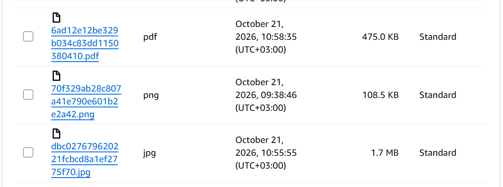

*Скрин. 16. Новые вложения в бакете.*

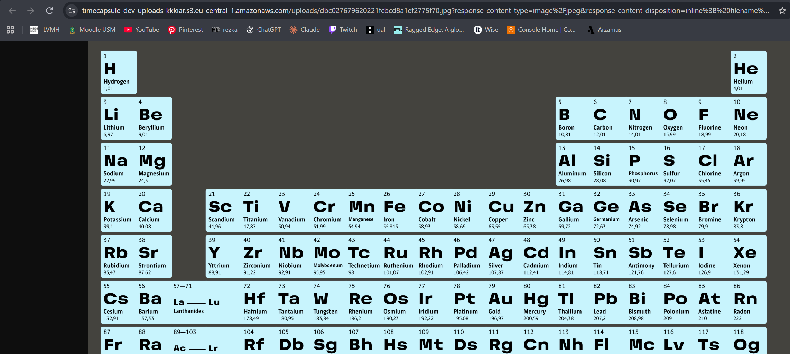

*Скрин. 17. Вложение открывается по подписанному URL: браузер получает файл напрямую из S3.*

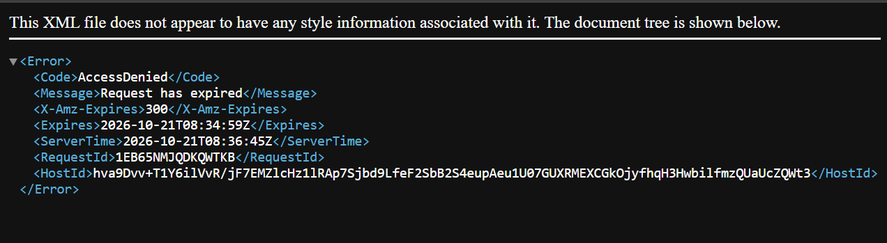

*Скрин. 18. Подписанный URL после 5 минут: Request has expired.*

**Почему ссылку, которую пользователь переслал другу, не нужно специально отзывать?**
Ссылка действует всего 5 минут и потом сама перестает работать. Приложение выдает ее только после проверки прав и каждый раз новую, так что пересланная ссылка быстро становится бесполезной.

**Что осталось в бакете после удаления капсулы и когда это исчезнет окончательно?**
Из за версионирования в бакете остались версия файла и маркер удаления. Правило жизненного цикла удаляет неактуальные версии через 90 дней, но две самые новые оставляет, поэтому единственная версия удаленного файла сама не исчезнет. Окончательно ее можно убрать, удалив версию вручную в консоли.

## Задание 13. Сервер без состояния

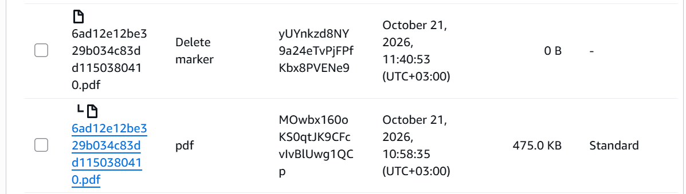

*Скрин. 19. Приложение работает без локальной папки uploads: вложения приходят из S3.*

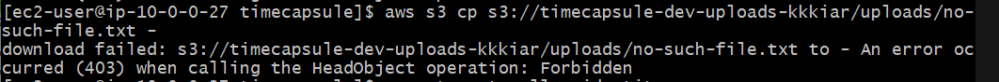
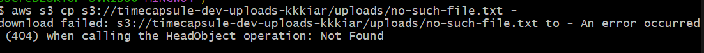

*Скрин. 20. Запрос несуществующего объекта: ответ на сервере и ответ у меня в Git Bash.*

**Почему S3 ответил мне и серверу по разному, хотя объекта нет в обоих случаях? Зачем S3 так поступает?**
У меня есть право ListBucket, поэтому S3 честно ответил, что объекта нет, то есть ошибка 404. У роли сервера этого права после уменьшения политики нет, и S3 ответил отказом 403. Так сделано, чтобы тот, у кого нет права на список, не мог перебором выяснять, какие файлы лежат в бакете.

**Что теперь нужно сделать, чтобы заменить app-server новым сервером без потери данных?**
Данных на сервере больше нет: файлы лежат в S3, а база на db-server. Нужно запустить новый сервер, привязать к нему роль timecapsule-dev-app-role, склонировать репозиторий, выполнить composer install и создать env с настройками базы и бакета.

## Задание 14. Архитектура и решение

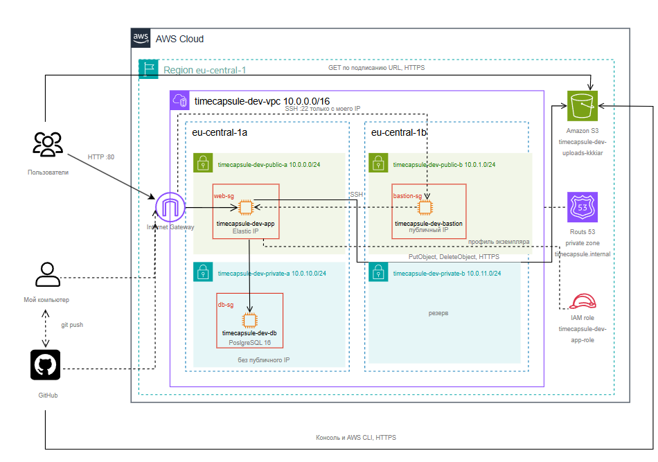

*Скрин. 21. Архитектура проекта: бакет S3 вне VPC, роль у app-server, запросы приложения к S3 и скачивание вложений браузером по подписанному URL.*

Решение о хранении вложений записано в файле: [ADR-0003](../adr/0003-attachment-storage.md).

---

# 3. Вопросы для устной защиты

**Как проходит запрос на скачивание вложения от нажатия ссылки до получения файла? Где проверяются права пользователя приложения, а где права роли?**
Браузер идет в приложение. Приложение проверяет, что пользователь вошел, что капсула его и что она уже открыта. Права пользователя проверяются только здесь. Потом приложение подписывает ссылку ключами роли сервера и отвечает перенаправлением. Браузер идет в S3 по этой ссылке, S3 проверяет подпись и срок, а также то, что у роли есть право на чтение этого объекта и что запрос идет по HTTPS. Права роли проверяет S3.

**Какие настройки бакета и какие свойства подписанного URL не дают постороннему открыть вложение по прямому адресу объекта?**
Бакет закрыт настройкой Block all public access, и прямой Object URL дает AccessDenied. Политика бакета запрещает запросы без HTTPS. Имена файлов случайные, их нельзя угадать. Подписанный URL действует 5 минут, а подпись привязана к ключу объекта.

**Почему приложение отдает файлы через подписанный URL, а не открывает бакет для чтения всем?**
Если открыть бакет, любой смог бы скачать любой файл без проверки прав, в том числе вложения запечатанных капсул. Через подписанный URL решение принимает приложение, и ссылка работает недолго.

**Как изменится схема, если вложения должны пережить отказ всего региона eu-central-1?**
Нужна репликация бакета в другой регион, копия приложения и базы в этом регионе и переключение адреса сайта на запасной регион через DNS. Для базы нужна реплика в другом регионе.

---

# 4. Итог

В работе я создала закрытый бакет с шифрованием, версионированием, правилом жизненного цикла и политикой только для HTTPS. Потом я перенесла вложения приложения с диска сервера в S3, настроила роли с минимальными правами и перешла на подписанные ссылки. Теперь сервер приложения не хранит данные пользователей.

