# Отчет по лабораторной работе 5. Облачные базы данных. Amazon RDS

* ФИО: Кайнар Анна
* Группа: IA2403
* Специальность: Informatică aplicată
* Выбранный уровень: продвинутый
* Репозиторий: https://github.com/kkkiar-cloud/timecapsule

---

# 1. Базовый уровень

## Задание 1. Размещение и доступ к базе

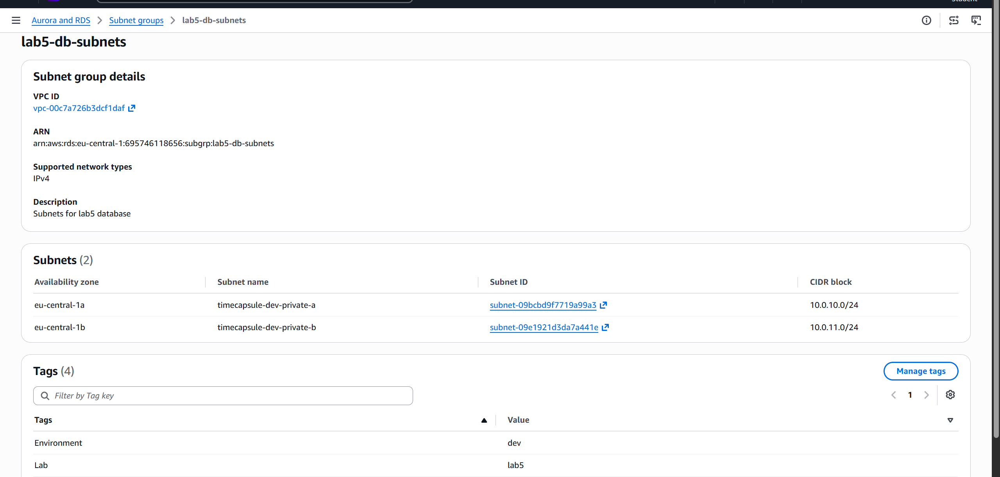

*Скрин. 1. Группа подсетей lab5-db-subnets из приватных подсетей private-a и private-b.*

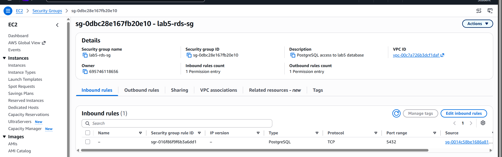

*Скрин. 2. Входящие правила lab5-rds-sg: порт 5432 открыт только для группы lab5-web-sg.*

**Почему для ограничения доступа удобнее использовать Security Group источника, а не его IP-адрес?**
Группа описывает все серверы, которые в ней состоят, а не конкретные адреса. Если сервер заменят и адрес изменится, правило продолжит работать. С адресом пришлось бы править правило при каждой замене, а диапазон сети открыл бы базу всем серверам подряд.

**Зачем указывать две подсети, если учебная база будет работать в одной зоне?**
RDS требует, чтобы группа подсетей охватывала минимум две зоны доступности. Это нужно, чтобы можно было разместить реплику или резервный экземпляр в другой зоне и перенести базу при необходимости. С одной подсетью группу создать нельзя.

## Задание 2. База RDS

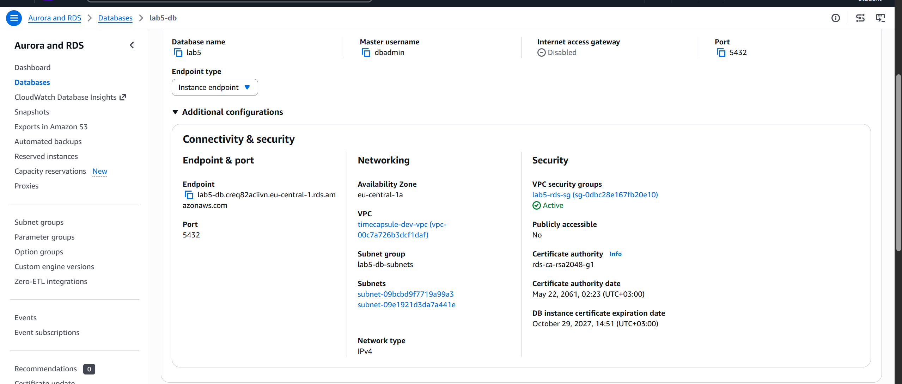

*Скрин. 3. База lab5-db в приватной подсети без публичного доступа, с группой безопасности lab5-rds-sg.*

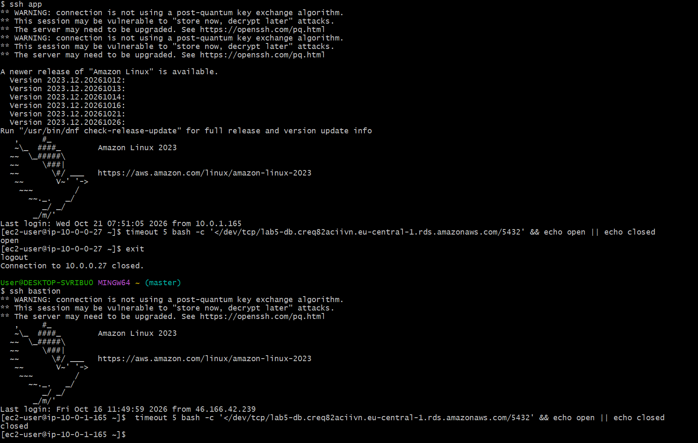

*Скрин. 4. Проверка порта 5432: с app-server порт открыт, с bastion закрыт.*

База создана по условию: PostgreSQL, класс db.t4g.micro, хранилище 20 ГиБ без автоматического увеличения, пользователь dbadmin, группа подсетей lab5-db-subnets, зона eu-central-1a, без публичного доступа, шифрование и защита от удаления включены. Срок хранения резервных копий на бесплатном плане можно было поставить только 1 день, поэтому в отчете он 1 день, а не 7.

**Как убедиться, что база принимает подключения только с нужного сервера?**
Нужно проверить порт 5432 с двух серверов. С app-server, у которого есть группа lab5-web-sg, порт открыт. С bastion, который в этой группе не состоит, порт закрыт. Кроме того, у базы выключен публичный доступ, поэтому из интернета до нее нет пути.

**Почему для базы выбрана зона eu-central-1a?**
В этой зоне работает app-server. Так между сервером и базой меньше задержка и нет платы за трафик между зонами.

**От чего защищает deletion protection, а от чего нет?**
Она защищает базу от случайного удаления целиком, пока флаг включен. Она не защищает данные внутри базы: команды DELETE и DROP TABLE выполняются как обычно. Она также не спасает при ошибках приложения и при отказе зоны.

## Задание 3. Подключение к базе

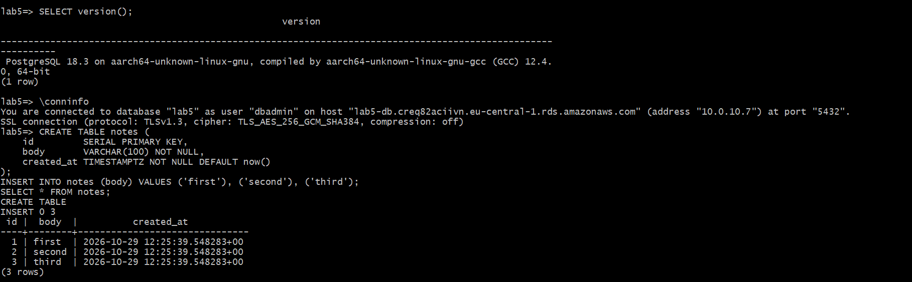

*Скрин. 5. Подключение к lab5-db с app-server: вывод conninfo и таблица notes.*

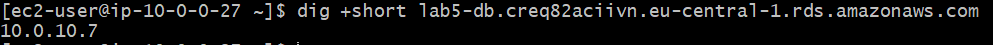

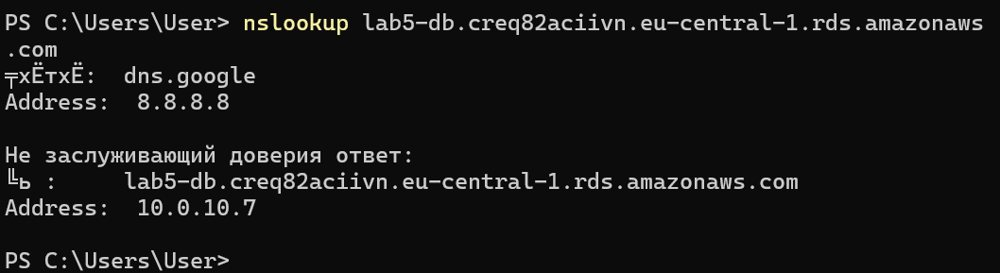
*Скрин. 6. Адрес базы lab5-db, определенный с app-server и со своего компьютера.*

Я подключилась к базе командой psql под пользователем dbadmin, проверила версию и соединение, создала таблицу notes и добавила три строки. С app-server имя endpoint разрешилось в приватный адрес из подсети private-a. Со своего компьютера имя тоже дает приватный адрес, но подключиться по нему нельзя, потому что у этого адреса нет маршрута из интернета.

## Задание 4. Реплика для чтения

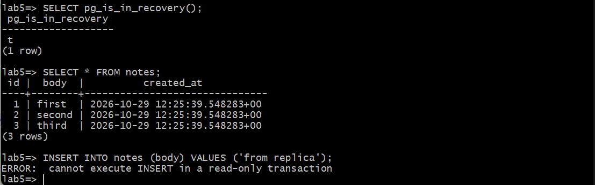

*Скрин. 7. Ошибка INSERT на реплике: запись на реплике для чтения невозможна.*

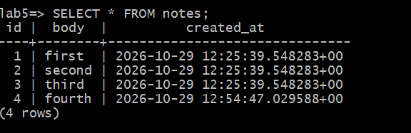

*Скрин. 8. Строка fourth, добавленная на основной базе, появилась на реплике.*

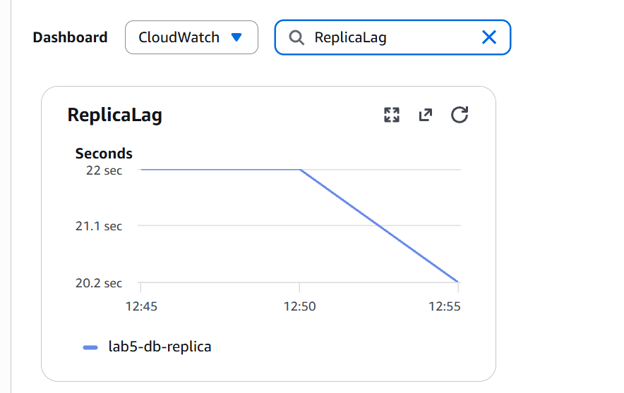

*Скрин. 9. Метрика ReplicaLag: отставание реплики от основной базы.*

**Почему INSERT на реплике не выполнился?**
Реплика работает в режиме только для чтения: она получает изменения от основной базы и сама их не делает. На основной базе pg_is_in_recovery возвращает f, а на реплике t. Если бы на реплике можно было писать, данные двух баз разошлись бы.

**Чем реплика для чтения отличается от резервного экземпляра Multi-AZ?**
Реплика это отдельный экземпляр со своим адресом, который отвечает на запросы чтения. Она получает изменения с небольшой задержкой и сама не подменяет основную базу при отказе. Резервный экземпляр Multi-AZ стоит в другой зоне, получает изменения синхронно, не имеет своего адреса для запросов и нужен для автоматического переключения при отказе.

## Задание 5. Восстановление после ошибки

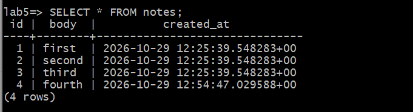

*Скрин. 10. Строки таблицы notes в восстановленной копии lab5-db-restore.*

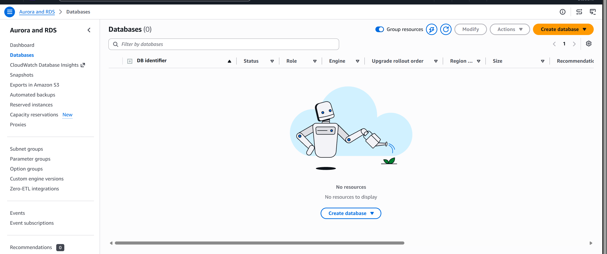

*Скрин. 12. Список баз после завершения Части 1, учебных баз не осталось.*

Я запомнила время командой SELECT now() AT TIME ZONE UTC, через минуту удалила все строки таблицы notes и увидела, что таблица опустела и на реплике. Потом удалила реплику, дождалась, пока Latest restore time станет позже запомненного времени, и восстановила базу в новый экземпляр lab5-db-restore. В копии были все четыре строки. После проверки я удалила копию, затем основную базу, группу подсетей и группы безопасности.

**Почему реплика не спасла данные?**
Реплика повторяет все изменения основной базы, в том числе удаление. Через мгновение строки исчезли и на ней. Реплика помогает при нагрузке и доступности, но не защищает от ошибок пользователя.

**Почему восстановление создает новую базу, а не откатывает старую?**
Восстановление берет резервную копию и журнал изменений и собирает из них новый экземпляр на нужный момент. Старая база при этом остается нетронутой, поэтому можно сначала проверить данные в копии, забрать нужное и только потом решить, что делать с исходной базой. У копии новый адрес, и приложение нужно переключить на него.

---

# 2. Продвинутый уровень

## Задание 6. База приложения

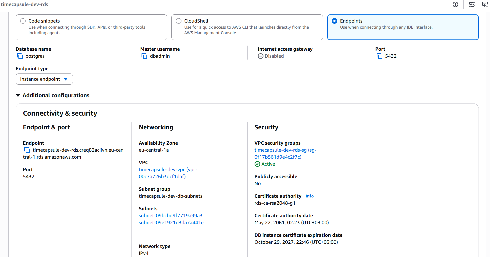

*Скрин. 13. База timecapsule-dev-rds в приватной подсети: адрес, группа подсетей и группа безопасности.*

Группа подсетей timecapsule-dev-db-subnets состоит из двух приватных подсетей в разных зонах. База timecapsule-dev-rds создана в зоне eu-central-1a без публичного доступа, с группой безопасности timecapsule-dev-rds-sg, шифрованием и защитой от удаления. Поле Initial database name я оставила пустым, базу timecapsule создала сама в задании 8. Срок хранения копий на бесплатном плане был 1 день.

**Какие параметры базы приложения вы выбрали бы иначе для рабочей системы с реальными пользователями? Почему?**
Я включила бы режим Multi-AZ, чтобы база переключалась на другую зону сама. Взяла бы класс мощнее db.t4g.micro, потому что у него всего 1 ГиБ памяти. Поставила бы срок хранения копий до 35 дней, чтобы можно было откатиться дальше назад, и включила бы автоматическое увеличение хранилища. Защита от удаления и шифрование остались бы включены.

## Задание 7. Ночная остановка базы

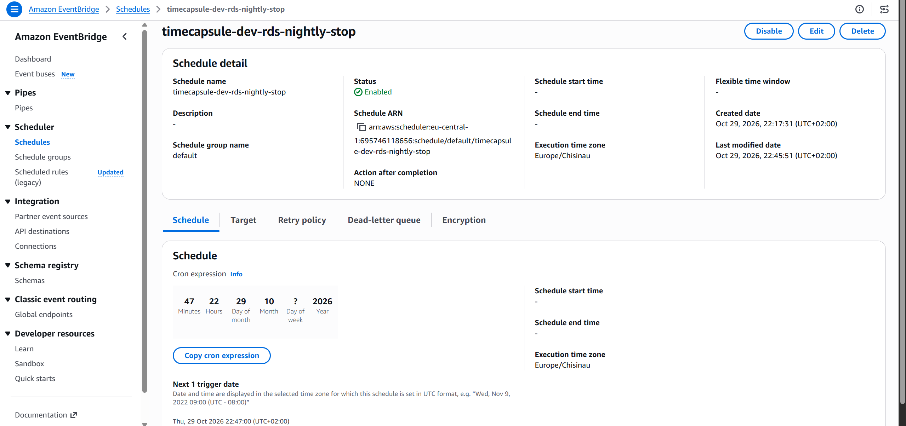

*Скрин. 14. Расписание timecapsule-dev-rds-nightly-stop: остановка базы по cron в часовом поясе Europe/Chisinau.*

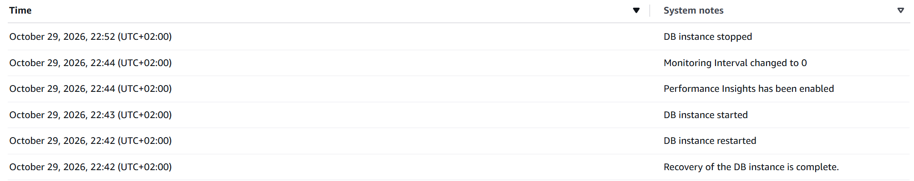

*Скрин. 15. Событие остановки базы в Logs and events после срабатывания расписания.*

Я создала политику timecapsule-dev-rds-stop, которая разрешает только действие StopDBInstance для одной базы. Потом создала роль timecapsule-dev-scheduler-role, которую может брать на себя только scheduler.amazonaws.com. Расписание вызывает действие StopDBInstance с параметром DbInstanceIdentifier равным timecapsule-dev-rds. Для проверки я сначала ставила время через несколько минут, а потом заменила его на постоянное выражение 0 23 * * ? *, то есть каждый день в 23:00.

**Зачем расписанию своя роль, если вы и сами можете остановить базу?**
Расписание срабатывает не от моего имени и не имеет моих прав. Когда наступает время, оно берет на себя роль и действует с ее правами. Без роли у него не было бы права остановить базу.

**Почему роль может остановить только одну базу?**
В политике роли в поле Resource указан адрес только одной базы. Это принцип минимальных прав: если роль или расписание будут использованы не по назначению, они смогут остановить только эту базу и больше ничего.

## Задание 8. Пользователь и база данных

Я подключилась к экземпляру с app-server под dbadmin к базе postgres, создала пользователя timecapsule, задала ему пароль из DB_PASSWORD командой password, выдала роль командой GRANT и создала базу timecapsule с владельцем timecapsule.

**Почему приложению нужен отдельный пользователь, а не dbadmin?**
У dbadmin слишком много прав: он может создавать базы и пользователей и видит все. У пользователя timecapsule есть права только на его базу. Если приложение взломают, ущерб будет ограничен одной базой, а пароль приложения можно сменить, не трогая администратора.

## Задание 9. Перенос данных

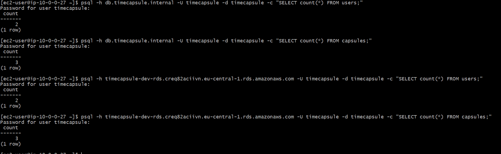

*Скрин. 16. Количество строк в таблицах users и capsules в старой базе на db-server и в новой базе RDS.*

Я выгрузила данные с db-server командой pg_dump с ключами no-owner и no-privileges, загрузила их в RDS командой psql и сравнила количество строк в таблицах users и capsules в обеих базах. Числа совпали. Файл выгрузки я удалила, потому что в нем лежат хеши паролей пользователей. Все это время приложение не открывала.

## Задание 10. Переключение приложения

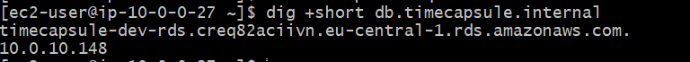

*Скрин. 17. Вывод dig для db.timecapsule.internal на app-server: имя указывает на адрес базы RDS.*

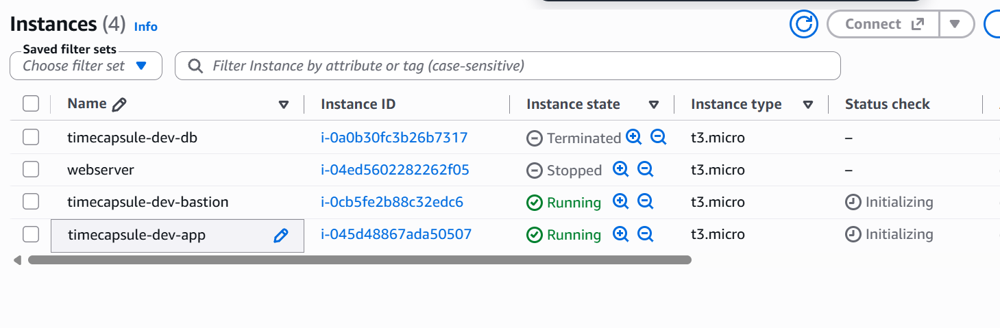

*Скрин. 18. Капсула, созданная после переключения, видна в таблице capsules в RDS.*

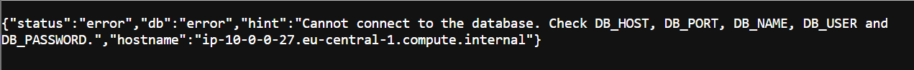

*Скрин. 19. Список серверов после удаления db-server.*

Я удалила запись A db в зоне timecapsule.internal и сразу создала запись CNAME db на адрес базы RDS. Шифрование соединения PHP включает сам, поэтому настройки приложения не менялись. Потом я проверила health, создала капсулу и нашла ее в таблице capsules в RDS. После этого остановила db-server, убедилась, что приложение работает без него, и удалила сервер.

**Почему не пришлось менять DB_HOST?**
Приложение подключается по имени db.timecapsule.internal. Я заменила запись, на которую указывает это имя, а само имя осталось прежним. Поэтому в env менять ничего не нужно.

**Какие обязанности из ЛР3 перешли к AWS, а какие остались за вами?**
К AWS перешли обновления СУБД и операционной системы, автоматические резервные копии и восстановление на любой момент, замена оборудования и мониторинг сервера. За мной остались пользователи и права, схема и данные, настройка сети и групп безопасности, контроль расходов, остановка базы и проверка того, что копии действительно подходят для восстановления.

## Задание 11. Обслуживание базы

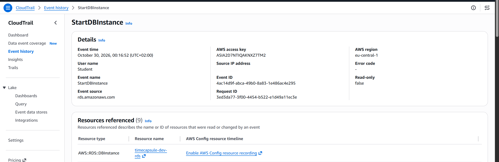

*Скрин. 20. Ответ health во время перезагрузки базы: приложение не может подключиться.*

*Скрин. 21. Событие StopDBInstance в CloudTrail.*

Я перезагрузила базу и во время перезагрузки обновляла health. Потом посмотрела события базы на вкладке Logs and events, остановила базу, открыла приложение, запустила базу и проверила приложение снова.

**Что показывал health во время перезагрузки?**
Статус error и подсказку, что не удается подключиться к базе. Приложение само работало, но не могло открыть соединение. После перезагрузки health снова показал db равно ok.

**Изменился ли endpoint после остановки и запуска?**
Нет, адрес остался прежним, поэтому запись CNAME в Route 53 менять не нужно.

**Какую ошибку получает расписание, если база уже остановлена?**
Остановить можно только базу в состоянии Available. Если база уже остановлена, действие StopDBInstance не выполняется и возвращает ошибку о неподходящем состоянии базы. Ошибку видно в результатах вызова и в CloudTrail, а сам эффект нулевой, потому что база и так остановлена.

## Задание 12. Архитектура и решение

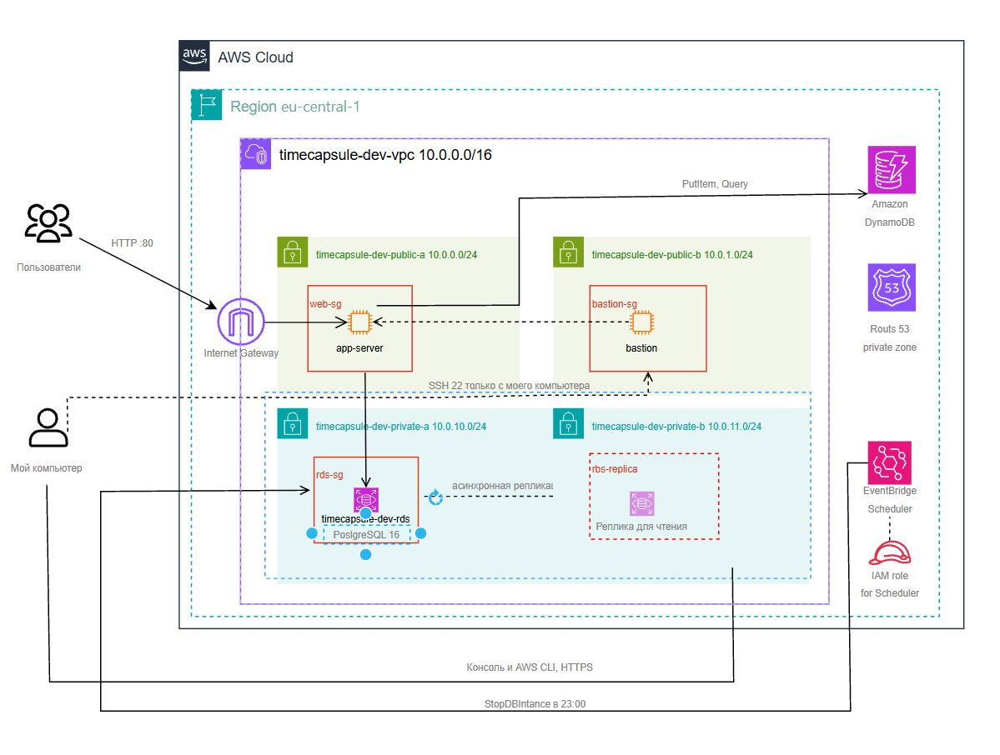

*Скрин. 22. Архитектура проекта: база RDS в приватной подсети вместо db-server, запись CNAME в Route 53, расписание остановки и роль для него.*

Решение о размещении базы приложения записано в файле: [ADR-0004](../adr/0004-database-hosting.md).

---

# 3. Вопросы для устной защиты

**Как проходит запрос от браузера до базы? Какие проверки проходит соединение на каждом шаге?**
Браузер идет на Elastic IP сервера app-server. Пакет попадает в Internet Gateway и по таблице маршрутов в подсеть public-a, где его проверяют Network ACL и группа безопасности web-sg, разрешающая порт 80. Приложение берет адрес базы по имени db.timecapsule.internal, которое через CNAME ведет на адрес RDS. Запрос идет по локальному маршруту в подсеть private-a, где его проверяют Network ACL и группа timecapsule-dev-rds-sg, пропускающая порт 5432 только от группы web-sg. База принимает только зашифрованное соединение и проверяет пароль пользователя timecapsule.

**Чем репликация отличается от резервного копирования?**
Репликация постоянно копирует изменения на другой экземпляр, поэтому копирует и ошибки, например случайное удаление. Она нужна для доступности и для чтения. Резервная копия вместе с журналом изменений позволяет вернуться на любой момент в прошлом, поэтому она защищает от ошибок.

**Как пережить отказ зоны eu-central-1a и сколько это будет стоить?**
Нужно включить режим Multi-AZ, тогда резервный экземпляр в зоне 1b подхватит работу сам. Также нужен второй сервер приложения в зоне 1b и балансировщик нагрузки. Multi-AZ примерно вдвое дороже, то есть около 26 долларов за три месяца вместо 13 или 14. Без Multi-AZ базу можно восстановить из копии в другую зону и переключить запись db, но это занимает время и можно потерять последние минуты данных.

**Как вы решили проблему автоматического запуска базы через 7 дней?**
AWS сам запускает базу, если она была остановлена 7 дней подряд. Расписание timecapsule-dev-rds-nightly-stop останавливает базу каждый вечер в 23:00. Поэтому база не простаивает неделю, а если я не запускаю ее несколько дней, она после автозапуска проработает только до следующего вечера. Так расходы остаются ограниченными.

---

# 4. Итог

В первой части я создала учебную базу в приватной подсети, подключилась к ней с app-server, проверила реплику для чтения и восстановила данные на момент до удаления, а потом удалила все учебные ресурсы. Во второй части я перенесла базу приложения с db-server в RDS, переключила приложение через запись CNAME, настроила ночную остановку базы и проверила, как приложение переносит перезагрузку и остановку.
