# Отчет по лабораторной работе 6. Масштабирование и балансировка нагрузки. Elastic Load Balancing, Amazon EC2 Auto Scaling

* ФИО: Кайнар Анна
* Группа: IA2403
* Специальность: Informatică aplicată
* Выбранный уровень: продвинутый
* Репозиторий: https://github.com/kkkiar-cloud/timecapsule

Все ресурсы создавались в регионе eu-central-1. Команды выполнялись на моем компьютере в Git Bash, CloudShell не использовался. В моем аккаунте действует лимит 8 vCPU для серверов этого типа, он повлиял на рост группы, об этом сказано в задании 3.

---

# 1. Базовый уровень

## Задание 1. Балансировщик

Я создала целевую группу lab6-tg с проверкой работоспособности по пути health каждые 10 секунд и балансировщик lab6-alb типа Application Load Balancer в подсетях public-a и public-b. Listener принимает HTTP на порту 80 и передает запросы в lab6-tg. Группа безопасности балансировщика принимает HTTP из любого места, а группа серверов принимает HTTP только от балансировщика, SSH только от bastion.

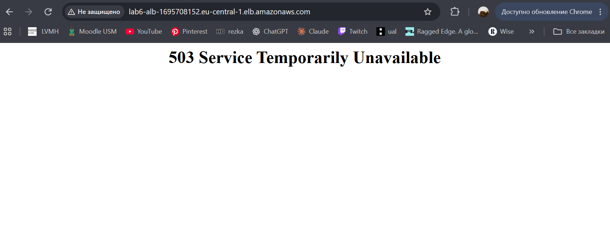

*Скрин. 1. Ответ балансировщика lab6-alb, пока в целевой группе нет серверов: ошибка 503.*

**Какой ответ вернул балансировщик и почему?**
Балансировщик вернул ошибку 503 Service Temporarily Unavailable. В целевой группе в этот момент не было ни одного сервера, поэтому передать запрос было некому.

**Зачем ему подсети в двух зонах?**
Application Load Balancer обязательно требует минимум две зоны доступности. Так он продолжает работать, если одна зона откажет, потому что его узлы есть и во второй зоне, и он может направить запросы на серверы в другой зоне.

## Задание 2. Группа Auto Scaling

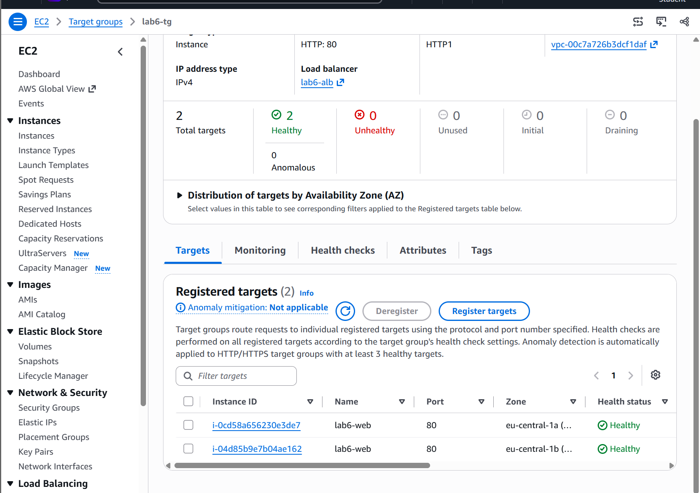

*Скрин. 2. Целевая группа lab6-tg: две цели в состоянии healthy.*

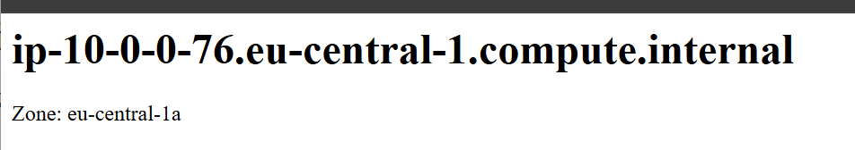

*Скрин. 3. Ответ первого сервера через балансировщик: имя сервера и зона eu-central-1a.*

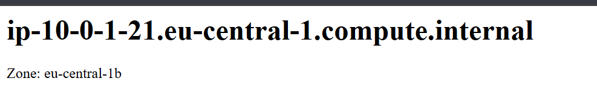

*Скрин. 4. Ответ второго сервера через балансировщик: имя сервера и зона eu-central-1b.*

**Чем группа Auto Scaling отличается от целевой группы?**
Группа Auto Scaling запускает и удаляет серверы, следит за их количеством и заменяет неисправные. Целевая группа это список получателей запросов для балансировщика, она проверяет их здоровье и принимает запросы. Группа Auto Scaling сама регистрирует свои серверы в целевой группе.

**Почему в шаблоне нет подсети?**
Подсеть выбирает сама группа Auto Scaling, потому что она распределяет серверы по подсетям двух зон. Один и тот же шаблон используется для всех зон, и если бы подсеть была в шаблоне, все серверы оказались бы в одной зоне.

## Задание 3. Нагрузка

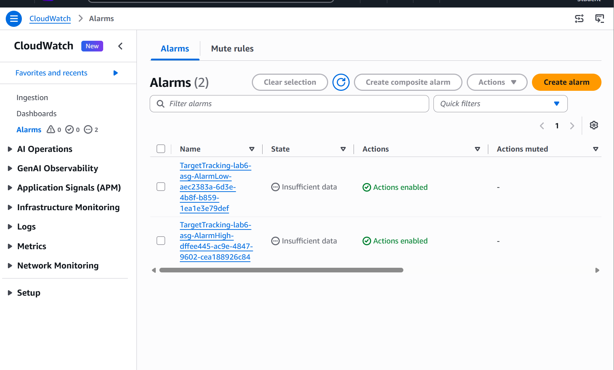

*Скрин. 5. Метрика RequestCountPerTarget на странице тревоги AlarmHigh.*

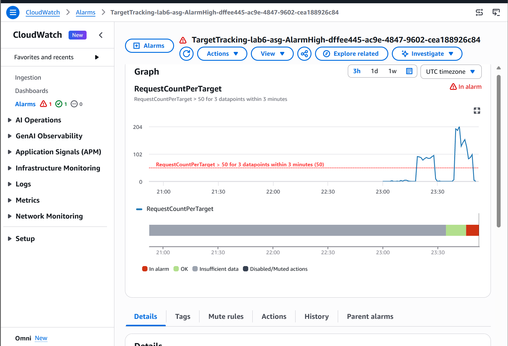

*Скрин. 6. История тревоги AlarmHigh: переход в состояние In alarm и запуск политики масштабирования.*

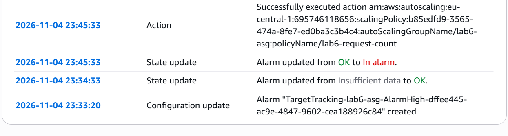

*Скрин. 7. Вкладка Activity: группа выросла под нагрузкой, причина запуска серверов.*

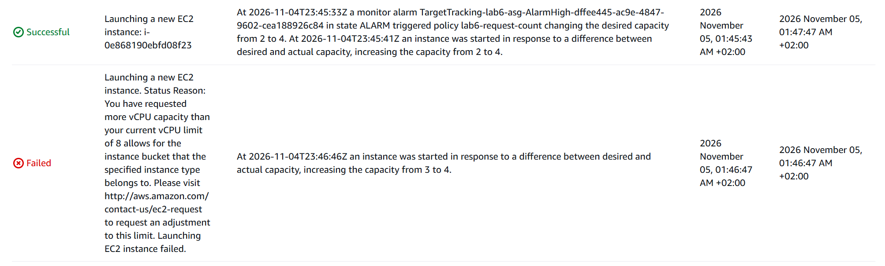

*Скрин. 8. Вкладка Activity: после окончания нагрузки группа уменьшилась.*

**Сколько серверов запустила группа и почему не больше четырех?**
Группа запросила рост с 2 до 4 серверов, но из за лимита vCPU в моем аккаунте, равного 8, часть запусков была отклонена. Фактически поднялось три сервера, а потом четвертый при повторной попытке, когда освободилось место. Больше четырех группа не запускает, потому что максимальный размер группы равен 4.

**Почему метрика упала после запуска новых серверов, хотя запросов не стало меньше?**
Метрика показывает число запросов на один сервер. Общий поток запросов тот же, но он делится на большее число серверов, поэтому на каждый сервер приходится меньше запросов.

**Почему группа добавляет серверы быстрее, чем убирает?**
Добавлять серверы нужно сразу, пока они перегружены, поэтому AlarmHigh срабатывает за несколько минут. Убирать серверы можно спокойно, и AlarmLow требует, чтобы нагрузка была низкой 15 минут подряд. Так группа не удалит сервер раньше времени и не получит перегрузку и колебания размера.

---

# 2. Продвинутый уровень

## Задание 4. Сессии в DynamoDB

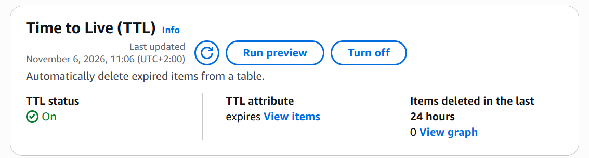

*Скрин. 9. Таблица timecapsule-dev-sessions с включенным TTL по атрибуту expires.*

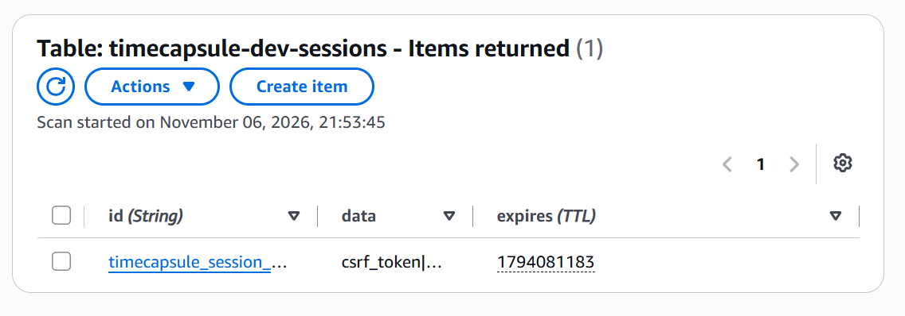

*Скрин. 10. Запись сессии пользователя в таблице DynamoDB.*

**Почему сессии нельзя оставить в файлах, когда серверов несколько?**
Файл сессии лежит на диске одного сервера. Если следующий запрос попадет на другой сервер, он не найдет этот файл, и пользователь окажется не залогинен.

**Зачем Node.js нужен initialized равный true?**
Этот параметр сообщает библиотеке, что таблица уже создана. Без него библиотека пытается создать таблицу при запуске, а у роли сервера нет такого права, и приложение получает ошибку AccessDeniedException. У меня приложение на PHP, поэтому этот параметр мне не понадобился.

## Задание 5. Приложение в группе Auto Scaling

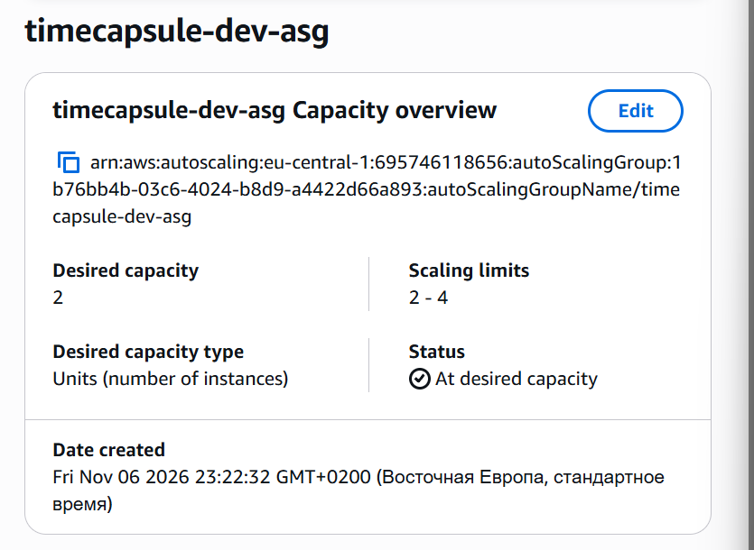

*Скрин. 11. Целевая группа timecapsule-dev-tg: два сервера группы Auto Scaling в разных зонах, оба Healthy.*

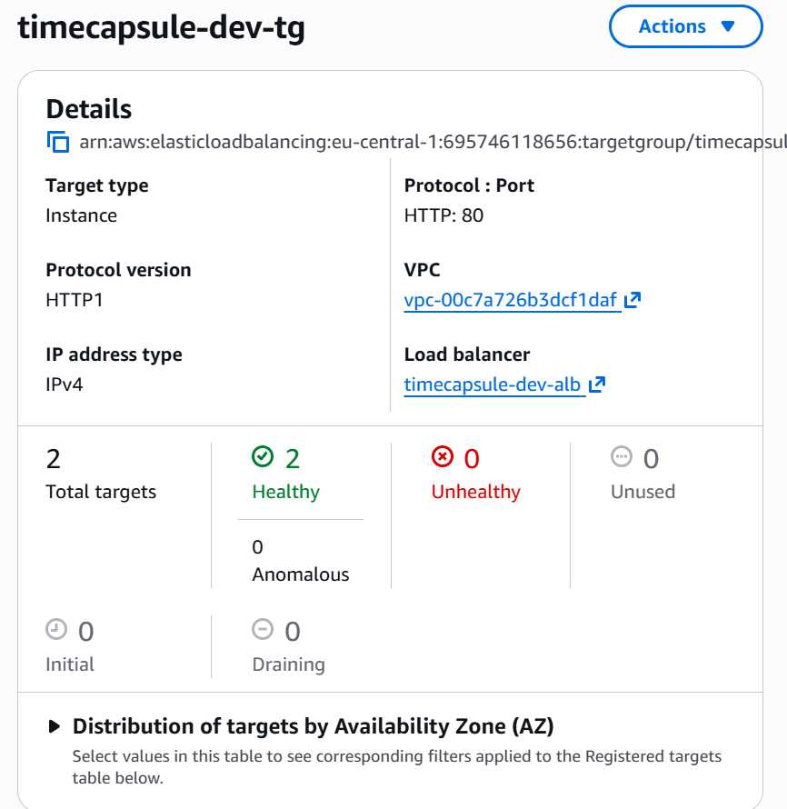

*Скрин. 12. Приложение по адресу балансировщика: в подвале в строке Served by первый сервер, вход выполнен.*

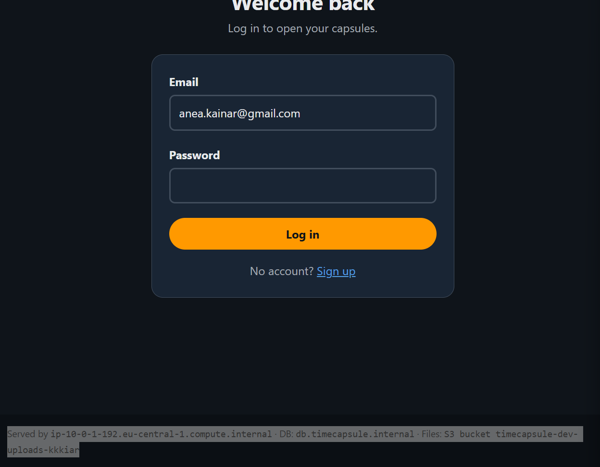

*Скрин. 13. Тот же вход, но в строке Served by другой сервер.*

**Почему Elastic IP больше не нужен?**
Пользователи заходят на приложение по DNS-имени балансировщика, и адреса отдельных серверов им не важны. Серверы группы приходят и уходят и получают обычные адреса, поэтому постоянный адрес у сервера не нужен.

**Почему у всех серверов группы одинаковые env и секреты?**
Все серверы запускаются из одного образа, в котором уже лежит env. Серверы должны быть взаимозаменяемыми: любой из них должен подключаться к той же базе, к тому же бакету и к той же таблице сессий. Ключей доступа в env нет, права дает одна и та же роль.

**Что станет с проверкой health, если базу остановить?**
Проверка начнет возвращать ошибку, потому что приложение проверяет подключение к базе. Балансировщик пометит цели как unhealthy, а группа с включенными проверками ELB начнет заменять серверы. Новые серверы тоже не смогут пройти проверку, поэтому замена идет по кругу. У меня так и случилось: пока база была остановлена, группа сделала больше сотни замен серверов каждые несколько минут. После запуска базы замены прекратились.

## Задание 6. Нагрузка на приложение

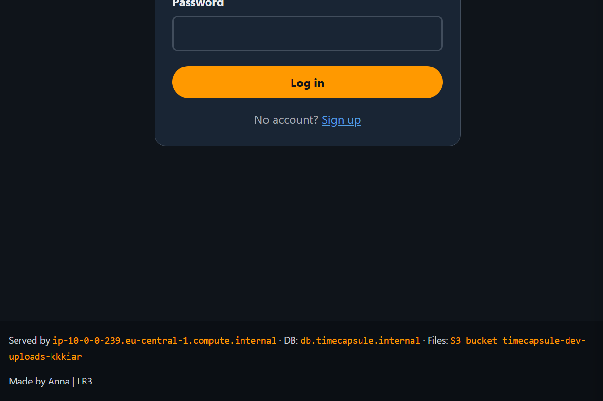

*Скрин. 14. Метрика RequestCountPerTarget на странице тревоги AlarmHigh группы timecapsule-dev-asg.*

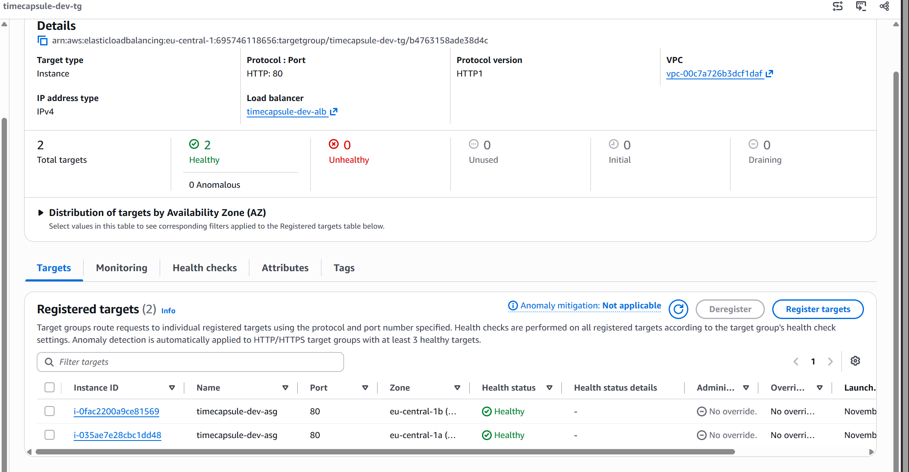

*Скрин. 15. История тревоги AlarmHigh: переход в состояние In alarm.*

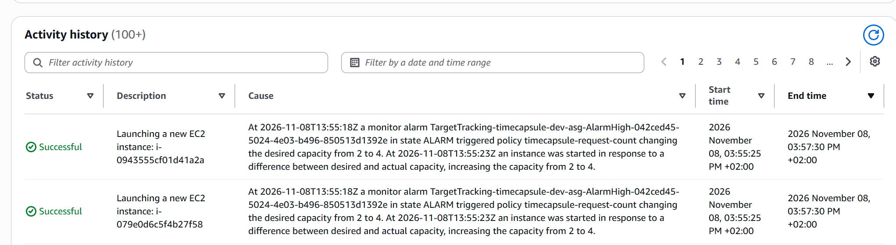

*Скрин. 16. Вкладка Activity группы timecapsule-dev-asg: рост группы под нагрузкой.*

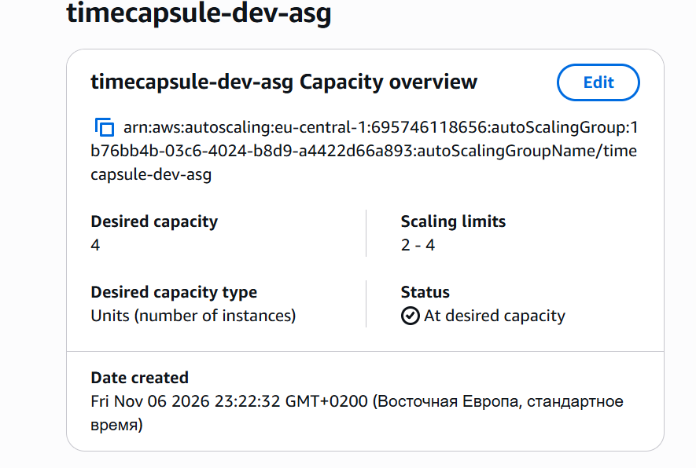

*Скрин. 17. Вкладка Activity группы timecapsule-dev-asg: уменьшение группы после нагрузки.*

**Пришлось ли входить заново, когда группа добавляла или удаляла серверы? Почему?**
Нет, входить заново не пришлось. Сессия лежит не на сервере, а в таблице DynamoDB, а в cookie хранится только идентификатор сессии. Любой новый сервер находит сессию в таблице по этому идентификатору.

## Задание 7. Архитектура и решение

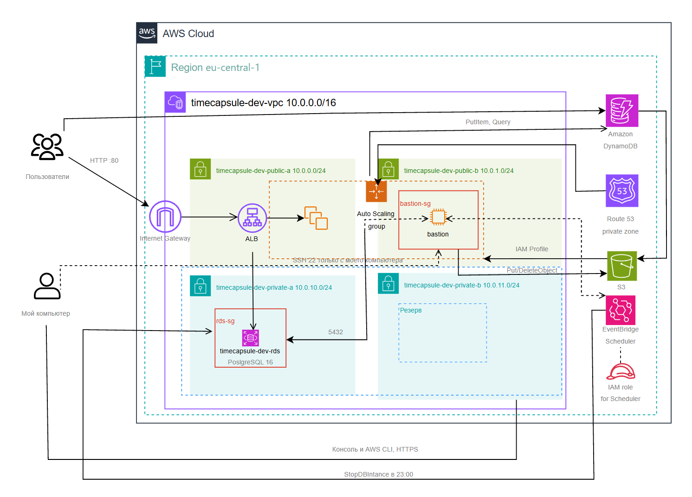

*Скрин. 18. Архитектура проекта: балансировщик перед группой серверов в двух зонах, таблица сессий DynamoDB, база RDS в приватной подсети, бакет S3 и роль серверов.*

Решение о хранении сессий записано в файле: [ADR-0005](../adr/0005-session-storage.md).

---

# 3. Вопросы для устной защиты

**Как проходит запрос от браузера до базы и таблицы сессий?**
Браузер обращается к DNS-имени балансировщика, запрос попадает в Internet Gateway и в Application Load Balancer, который стоит в двух публичных подсетях. Группа безопасности балансировщика пропускает порт 80, целевая группа выбирает исправный сервер, а группа серверов принимает HTTP только от балансировщика. Приложение читает сессию из таблицы DynamoDB по HTTPS, и права ему дает роль сервера с политикой на четыре действия над одной таблицей. Потом оно подключается к базе по имени db.timecapsule.internal, это запись CNAME на RDS. Группа безопасности базы пускает порт 5432 только от группы серверов, а база принимает зашифрованное соединение и проверяет пароль.

**Чем проверка балансировщика отличается от проверки группы Auto Scaling?**
Проверка балансировщика отвечает на вопрос, можно ли отправлять запросы на этот сервер, и смотрит на ответ по пути health. Проверка группы по умолчанию смотрит только на состояние самого сервера EC2, то есть запущен ли он. Когда включены проверки ELB, группа учитывает и результат балансировщика и заменяет сервер, который не прошел проверку.

**Что произойдет при отказе зоны eu-central-1a?**
Балансировщик перестанет отправлять запросы на серверы в зоне a и будет использовать серверы в зоне b, а группа запустит замену серверов в зоне b. Сессии останутся, потому что таблица DynamoDB хранится сразу в нескольких зонах. Но база RDS у меня работает в одной зоне eu-central-1a, поэтому приложение не сможет подключиться к базе, пока ее не восстановят из резервной копии в другой зоне или пока не будет включен режим Multi-AZ.

---

# 4. Итог

В первой части я создала балансировщик и группу Auto Scaling с учебными серверами nginx, дала им нагрузку и увидела, как группа растет и уменьшается, а потом удалила все ресурсы. Во второй части я перенесла сессии приложения в DynamoDB, создала образ и запустила приложение в группе за балансировщиком. Теперь серверы приложения взаимозаменяемы: пользователь не теряет вход, на какой бы сервер ни попал его запрос.
